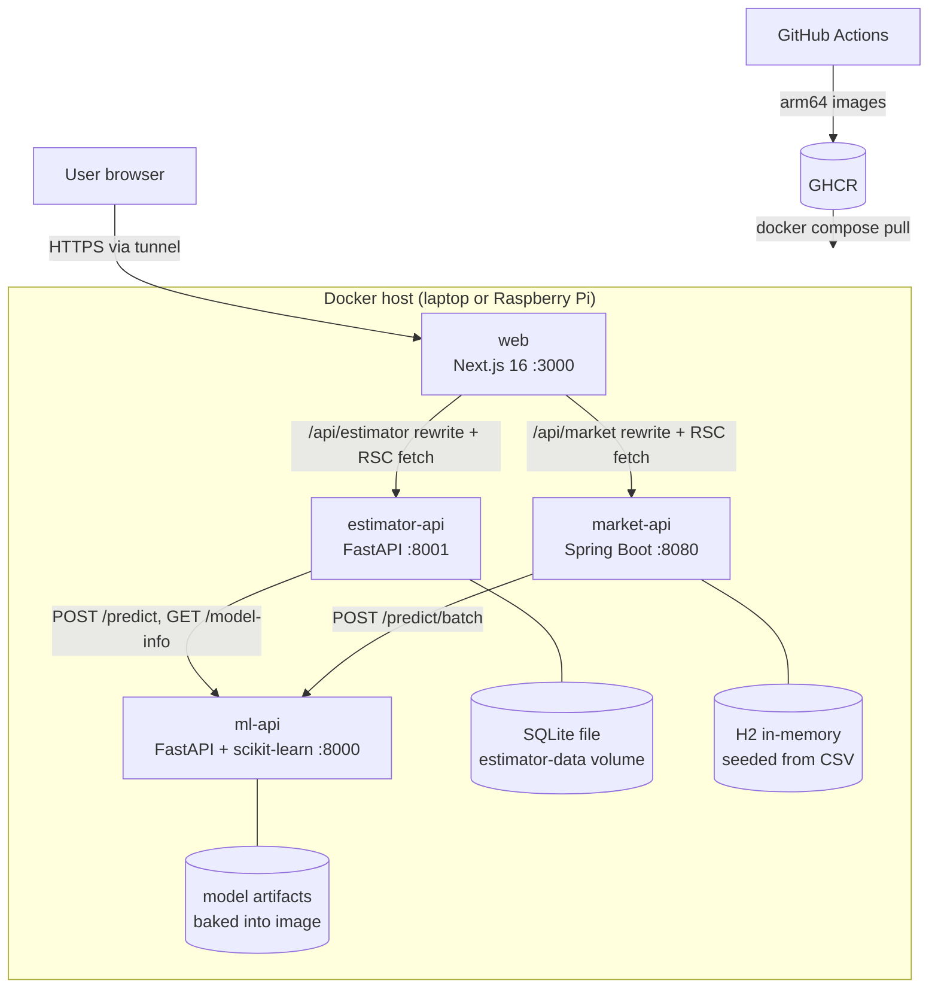
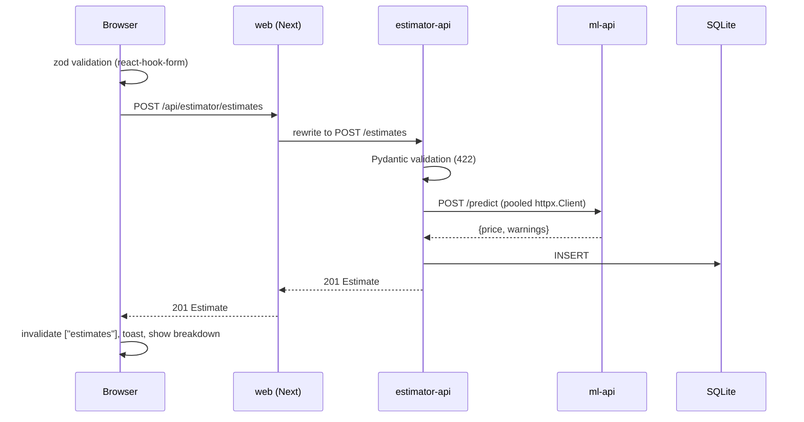
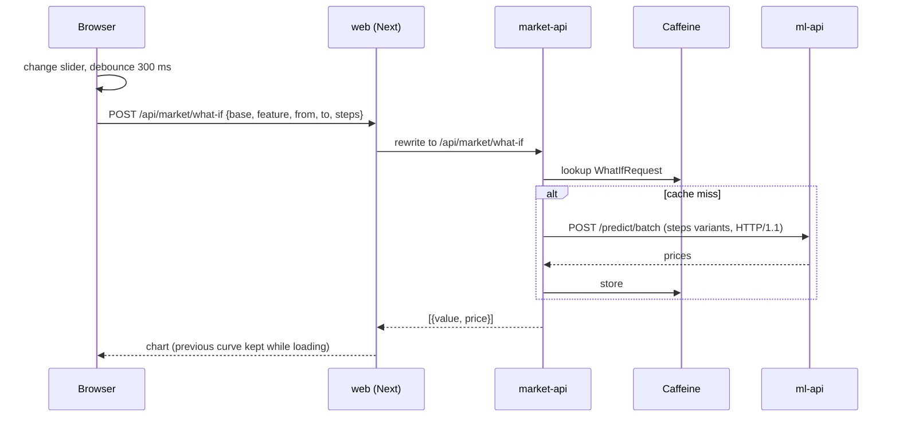
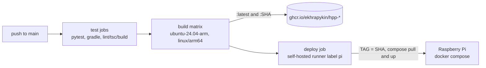

# Architecture

System view of the Housing Prediction Portal. Each service has its own deep dive: [ml-api](ml-api/ARCHITECTURE.md), [estimator-api](estimator-api/ARCHITECTURE.md), [market-api](market-api/ARCHITECTURE.md), [web](web/ARCHITECTURE.md).

## System context and containers

## Responsibilities and boundaries

| Service | Owns | Calls | Called by |
|---|---|---|---|
| ml-api | The trained model and its card (`/model-info`) | nobody | estimator-api, market-api |
| estimator-api | Estimate history (SQLite) | ml-api | web |
| market-api | Market dataset view (H2), aggregates, exports, what-if | ml-api | web |
| web | UI, URL state, browser cache | estimator-api, market-api | browser |

Rules:

- The browser never talks to a backend directly. It calls `/api/*` on the portal's own origin, and the portal proxies.
- Only the two app backends call ml-api; the portal reaches the model card through `estimator-api /model-info`.
- No service reads another's storage. The 50-row dataset is copied into `ml-api/data` (training) and `market-api/src/main/resources/data` (seed); it is read-only reference data.

## Cross-cutting contracts

| Contract | Detail |
|---|---|
| JSON naming | snake_case everywhere. Python models use snake_case fields; market-api sets `spring.jackson.property-naming-strategy: SNAKE_CASE` and binds snake_case query params with `@BindParam`. |
| Errors | Non-2xx responses carry `{"detail": ...}`. estimator-api uses an `AppError` handler; market-api returns `ProblemDetail` (which has `detail`); ml-api uses FastAPI defaults. `detail` is a string, except FastAPI validation 422s, where it is a list of issues; the portal's `apiFetch` turns that list into a readable `field: message` string. Validation status differs: 422 in Python, 400 in Java. |
| Health | ml-api and estimator-api `GET /health`, market-api `GET /actuator/health`, web `GET /`. Compose healthchecks and `depends_on: service_healthy` order startup: ml-api, then the two app backends, then web. |
| Feature schema | The 7 features with identical bounds are defined in four places (below). |

### The 7-feature schema, mirrored four times

| Copy | File | Role |
|---|---|---|
| Source of truth | `ml-api/app/schemas.py` (+ `app/ml/features.py`) | What the model accepts |
| estimator-api | `estimator-api/app/schemas.py` | Validate before calling ml-api |
| market-api | `market-api/.../dto/HouseFeatures.java` | Validate the what-if base house |
| web | `web/lib/house-schema.ts` (zod), `web/lib/types.ts` | Instant form errors, typed UI |

Why mirror instead of share: three languages and four deployables; a shared package or codegen from ml-api's OpenAPI would be more machinery than a 7-field schema that hasn't changed. Each copy fails fast at its own boundary, and ml-api still validates last. The comments in each copy point back to ml-api. The trigger to change this is a schema change or a fifth consumer: generate clients from ml-api's OpenAPI.

## Flow: create an estimate

If ml-api is unreachable, estimator-api returns 503 `{detail}` and the form shows it as a toast.

## Flow: market what-if

## Caching across layers

| Layer | What | Policy |
|---|---|---|
| market-api, Caffeine | `summary`, `segments`, `whatIf` | Record keys; `maximumSize=500`, `expireAfterWrite=10m` |
| web, Next fetch cache | Server-side market reads | `revalidate: 300`, tag `market` |
| web, no cache | Server-side estimator reads | `cache: "no-store"` (user data) |
| web, TanStack Query | Browser queries | `staleTime` 30 s (model info 10 min); mutations invalidate `["estimates"]` |
| ml-api | none | Model in memory; predictions are cheap |

The market data never changes at runtime, so time-based expiry is enough. Estimates are never cached on the server because every write must be visible on the next read.

## Deployment

- **Compose:** one file for laptop (`up --build`) and Pi (`pull` + `up -d --no-build`). Images are named `ghcr.io/ekhrapykin/hpp-<service>:${TAG:-latest}`. Memory limits: ml-api 512m, estimator-api 256m, market-api 640m (JVM `-Xmx256m`, SerialGC), web 384m.
- **Images:** ml-api trains inside `docker build`; market-api is a multi-stage JDK-to-JRE build; web is a multi-stage Next `standalone` build with backend URLs as build args. All four images run as a non-root user.
- **CI:** tests run on every push and PR. Images are built natively for arm64 on `ubuntu-24.04-arm` (no QEMU), with a GitHub Actions layer cache per service.
- **CD:** the deploy job runs on the Pi's self-hosted runner with `TAG=${{ github.sha }}`, so it deploys exactly the images built in that run rather than whatever `latest` is. It waits up to 150 s for all containers to be healthy and fails the job otherwise. Rollback is `TAG=<older sha> docker compose up -d`.
- **Exposure:** only port 3000 needs to be public (Tailscale Funnel or Cloudflare Tunnel). Backend ports are published for Swagger demos only.

## Tech choices

| Area | Choice | Rationale |
|---|---|---|
| Model API | Python 3.14, FastAPI >=0.162, scikit-learn >=1.9 | The standard ML stack; Pydantic validation and OpenAPI for free |
| Estimator backend | FastAPI + stdlib `sqlite3`, httpx | Same stack as ml-api; one table needs no ORM |
| Market backend | Java 21, Spring Boot 3.4.4, Gradle 8.14 (Kotlin DSL, version catalog) | Task asks for Java; Boot gives JPA, cache, validation, ProblemDetail, actuator |
| Market storage | H2 in-memory, Hibernate, JPA Specifications | Read-only 50-row dataset; composable filters |
| Market cache | Caffeine | In-process, no extra container |
| Exports | OpenPDF 2.4.0, hand-written CSV | Small, permissive PDF library |
| Portal | Next.js 16.4.3 App Router, React 19.3 | RSC for server-rendered market views, one origin for both apps |
| Client data | TanStack Query 5, TanStack Table 9 | Cache, invalidation, hydration from RSC |
| Forms/UI | react-hook-form, zod 4, Tailwind 4, shadcn, Recharts 3 | Typed validation, accessible primitives |
| Toolchain | mise, uv, Gradle wrapper, npm | One `mise install` pins everything |
| Runtime | Docker Compose on a Raspberry Pi (arm64), GHCR, GitHub Actions | Cheap, real deployment target |

## Decisions and trade-offs

**Three backends.** The task asks for a model API, a Python-backed app and a Java-backed app. Each backend owns one concern (model, estimates, market), and the model is a shared dependency behind HTTP instead of being loaded twice. Cost: more containers and duplicated contracts.

**SQLite and H2 instead of a real database.** Estimates are a single table with low write volume; market data is read-only reference data rebuilt from CSV at startup. No database container to run on a Pi. Cost: one replica per service, no shared data, history lives in a volume.

**Training at build time.** The image is the model: reproducible, no volume, no init job, and CI tests the same training code. Cost: retraining means a rebuild, and there is no model registry.

**Ridge over OLS or boosting.** With 50 rows and features correlated at 0.91-0.99, OLS coefficients are unstable, and boosting would overfit and lose the linear explanation the portal shows (contribution = coefficient x distance from mean). Ridge regularises and stays explainable. Cost: the alpha picked by `RidgeCV` is small, so coefficients are still unstable (see limitations).

**Rewrites instead of route handlers.** `next.config.ts` rewrites proxy `/api/*` with no code, keep one origin (no CORS), and keep backends private. Cost: destinations are fixed at build time, so the URLs are build args, and the proxy can't reshape errors.

**TanStack Query + RSC prefetch instead of Server Actions.** The estimator needs a client cache, invalidation after create/delete, and debounced what-if queries with previous data kept on screen. Server Actions would cover the mutations but not the cache. RSC prefetch into `HydrationBoundary` keeps the first paint server-rendered.

**Java 21, not 25.** Spring Boot 3.4 supports Java up to 24 and Gradle up to 8.x; running on JDK 25 needs Gradle 9. Java 21 is an LTS that fits Boot 3.4.4 and Gradle 8.14 without a toolchain jump.

**Next step: one shared Postgres instance.** Keep one database or schema per service with its own role: `estimator` (replaces SQLite), `market` if needed, and a shared read-only `housing` reference schema that replaces the two CSV copies. ml-api would train from `housing` in a one-shot `ml-train` job that writes the artifacts, instead of training during `docker build`. Sharing the instance is a hosting simplification, not shared ownership: only owners write, and there are no cross-schema joins in application code.

## Known limitations and next steps

- **Model coefficients are unstable.** The features are highly collinear, so single-feature coefficients have implausible signs (currently `square_footage`, `bedrooms` and `year_built` negative). Predictions are accurate, but the what-if curve can slope down as square footage rises, and the per-feature breakdown inherits the same problem. A larger fixed alpha trades a little R2 for sensible signs.
- **Schema duplicated four times**; generate clients from ml-api's OpenAPI if it changes.
- **Error contract is not uniform:** 400 vs 422 for validation, and FastAPI 422 `detail` is a list (the portal normalises it, other clients must handle both).
- **No auth;** the estimate history is shared by everyone.
- **No e2e tests,** and none of the portal's code is unit-tested.
- **Single host, no TLS termination of its own;** relies on the tunnel.
