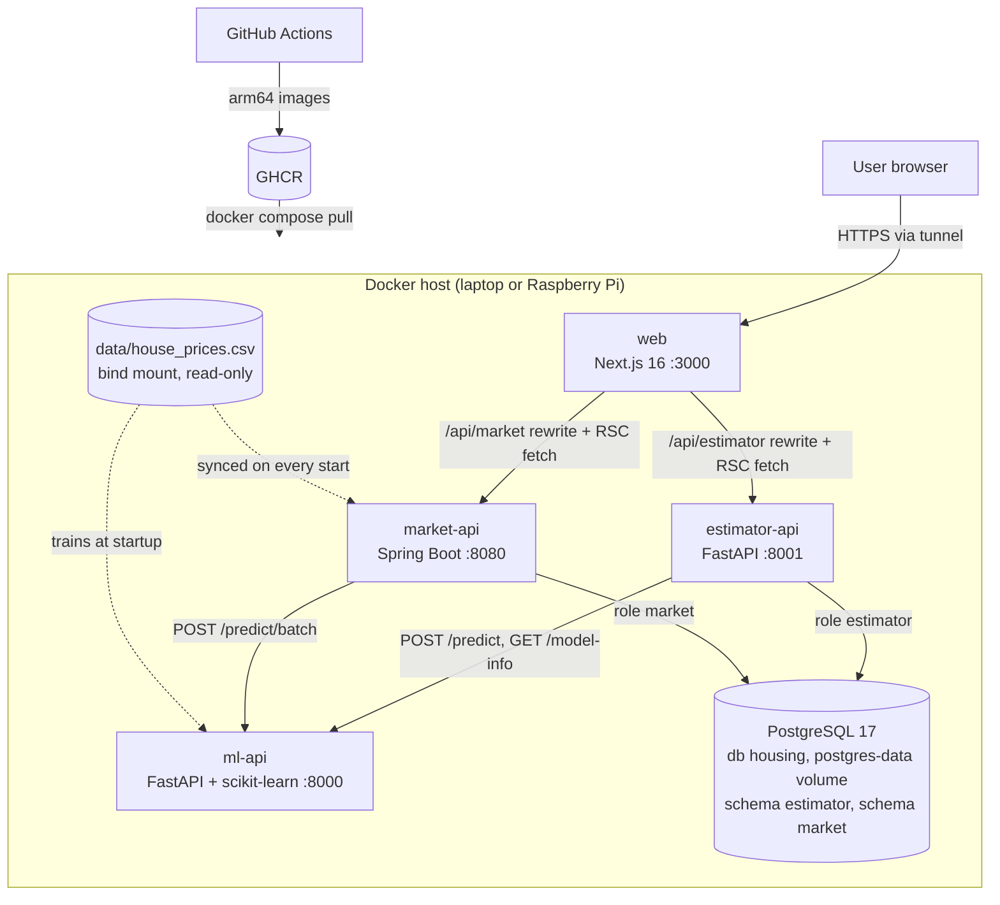
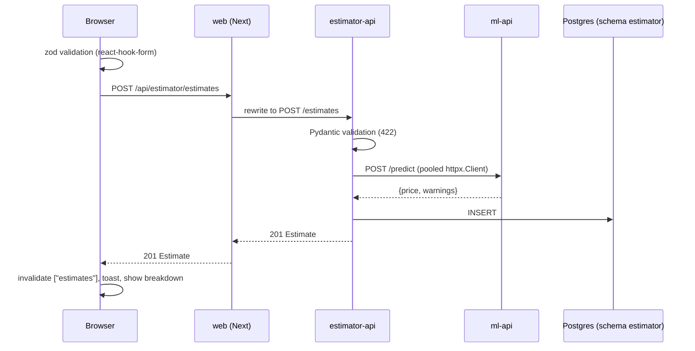
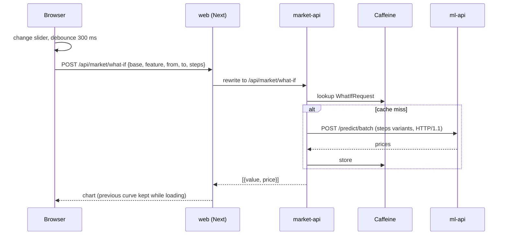
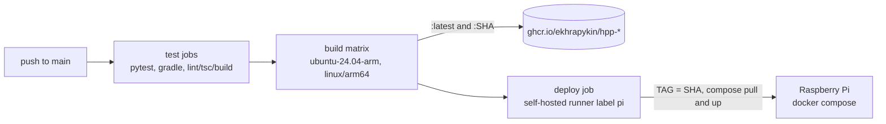

# Architecture

System view of the Housing Prediction Portal. Each service has its own deep dive: [ml-api](ml-api/ARCHITECTURE.md), [estimator-api](estimator-api/ARCHITECTURE.md), [market-api](market-api/ARCHITECTURE.md), [web](web/ARCHITECTURE.md).

## System context and containers



## Responsibilities and boundaries

| Service | Owns | Calls | Called by |
|---|---|---|---|
| ml-api | The model, trained at startup, and its card (`/model-info`) | nobody | estimator-api, market-api |
| estimator-api | Estimate history (Postgres schema `estimator`) | ml-api | web |
| market-api | Market dataset view (Postgres schema `market`, H2 locally), aggregates, exports, what-if | ml-api | web |
| web | UI, URL state, browser cache | estimator-api, market-api | browser |
| postgres | One database `housing`, schemas `estimator` and `market`, one role each | nobody | estimator-api, market-api |

Rules:

- The browser never talks to a backend directly. It calls `/api/*` on the portal's own origin, and the portal proxies.
- Only the two app backends call ml-api; the portal reaches the model card through `estimator-api /model-info`.
- No service reads another's storage. Each backend has its own Postgres role that can only touch its own schema, and there are no cross-schema joins. The 50-row dataset is one file, `data/house_prices.csv`, mounted read-only into ml-api (training) and market-api (synced into its schema on every start, so the market table is a read model of the file); it is reference data nobody writes.

## Cross-cutting contracts

Every service follows these. The schema contracts themselves (files, rule, contract tests) live in [`contracts/`](contracts/README.md).

| Contract | Detail |
|---|---|
| JSON naming | snake_case everywhere. Python models use snake_case fields; market-api sets `spring.jackson.property-naming-strategy: SNAKE_CASE` and binds snake_case query params with `@BindParam`. |
| Feature schema | The 7 features with identical bounds are defined in four places, pinned to [`contracts/`](contracts/README.md) by contract tests (below). |
| Errors, request id, rate limit, health | Sections below. |

### Errors

Every non-2xx response carries a JSON body with `detail`.

- `detail` is a **string** everywhere, except FastAPI validation errors (422), where it is a **list of `{loc, msg, type}`**.
- Python services (ml-api, estimator-api) answer validation failures with **422**; the Java service (market-api) answers with **400** (`ProblemDetail`, which has `detail`). estimator-api uses an `AppError` handler, ml-api FastAPI's defaults.
- market-api validation messages name fields by their snake_case JSON path (`base.square_footage`), like the Python services' `loc`.
- Status 429 (estimator-api writes) also carries `Retry-After`.
- Clients must accept both shapes; the portal's `readDetail` (`web/lib/clients/errors.ts`, used by both its browser and server transports) turns the list into a readable `field: message` string.

### Rate limiting

Behaviour: estimator-api limits writes, `POST /estimates` and `DELETE /estimates/{id}`, which share one budget per client (`RATE_LIMIT_WRITES`, default `20/minute`, slowapi). Reads are not limited. Over the limit: 429, `{"detail": "Too many requests. Try again in N seconds."}` and `Retry-After: N` (seconds). market-api's what-if has no limit of its own: the Caffeine cache and the `steps` cap (at most 50) bound its cost.

**Who is "a client".** The key is the TCP peer address, except when the peer is a *trusted proxy* (`TRUSTED_PROXIES`, default `web`, resolved to IPs on every write request): then it is the **right-most** `X-Forwarded-For` entry.

- Why only from trusted peers: `X-Forwarded-For` is just a header. `:8001` is published for Swagger, so anyone who can reach it could send a new value per request and never be limited. A peer that isn't the portal gets keyed by its own address.
- Why right-most: Next 16 doesn't append its own address to an existing `X-Forwarded-For`, and the tunnel (Tailscale Funnel or Cloudflare) appends the real client IP last. Everything to its left is client-supplied and can be forged; the last entry was written by infrastructure we trust.
- The trusted set is resolved per write request (Docker DNS, cheap at this rate), so recreating `web` with a new IP does not silently merge every portal user into one budget. Behind a different proxy chain the "right-most" rule has to be revisited.

Counters are in-memory per process (see [limitations](#limitations-and-future-work)).

### Request correlation

Header `X-Request-ID` ties one user action to the log lines of every service it touches. It is born at the first backend, not at the browser.

- Accepted from a caller only if it matches `^[A-Za-z0-9-]{1,64}$`; otherwise the service generates a UUID4 (this keeps log lines injection-free).
- **Generated by the first backend** that sees the request if absent. The portal's server-side estimator reads send a fresh one; browser requests through the rewrites carry none.
- **Echoed in every response** (errors included) and logged with every line of that request.
- **Forwarded to ml-api** by estimator-api and market-api on every outgoing call.
- The portal's error toasts show the first 8 characters as `ref xxxxxxxx`.

```mermaid
sequenceDiagram
  participant W as web
  participant B as backend (estimator-api / market-api)
  participant ML as ml-api
  W->>B: request (server-side estimator reads send a fresh UUID; rewrites send none)
  B->>B: valid incoming id or generate UUID4, put in ContextVar / MDC
  B->>ML: same header on the outgoing call
  ML->>ML: same rule, logs [req=id]
  ML-->>B: response with X-Request-ID
  B-->>W: response with X-Request-ID (also on errors)
  W->>W: toast: "<detail> · ref <first 8 chars>"
```

- Each service logs `[req=<id>]` on every line (`-` outside a request). The Python services log one line per request (method, path, status, ms) from the middleware and **disable uvicorn's access log** to avoid duplicates; market-api uses Spring's logging with an MDC pattern.
- The id is carried by a `ContextVar` (Python; FastAPI copies the context into its threadpool) or the MDC (Java; a request runs on one thread, virtual or not, and the ml-api call is synchronous on it). The ml-api clients add it to every outgoing call.
- Debugging recipe: copy the `ref` from a toast, then `docker compose logs estimator-api ml-api market-api | grep <ref>` (the first 8 characters are enough for a UUID).
- The portal's cached market reads send no id: Next puts request headers in the fetch cache key, so a fresh id per request would disable the cache. market-api generates one for them.

### Health endpoints

| Service | Endpoint |
|---|---|
| ml-api | `GET /health` |
| estimator-api | `GET /health` (also reports `ml_api: up/down`; always 200) |
| market-api | `GET /actuator/health` |
| web | `GET /` |
| postgres | `pg_isready` |

The probes are the compose healthchecks (defined once in `docker-compose.yml`, nowhere else), and `depends_on: service_healthy` orders startup: postgres and ml-api, then the two app backends, then web. The deploy job waits on the same health status.

### The 7-feature schema, mirrored four times, pinned by `contracts/`

| Copy | File | Role |
|---|---|---|
| Contract | `contracts/house-features.schema.json` (+ `contracts/market.json` for market query keys) | The agreed names, types and bounds |
| Native: ml-api | `ml-api/app/schemas.py` | What the model accepts |
| estimator-api | `estimator-api/app/schemas.py` | Validate before calling ml-api |
| market-api | `market-api/.../dto/HouseFeatures.java` | Validate the what-if base house |
| web | `web/lib/house-schema.ts` (zod), `web/lib/types.ts` | Instant form errors, typed UI |

Why mirror instead of share: three languages and four deployables; a shared package or codegen would be more machinery than a 7-field schema that hasn't changed. Each copy fails fast at its own boundary, and ml-api still validates last. Drift is caught by one contract test per service (`ml-api` and `estimator-api` `tests/test_contract.py`, market-api `ContractTest`, web `lib/contracts.test.ts` in `npm test`), all comparing the native schema with the files in `contracts/`. To change a bound: edit the contract first, then every mirror. Contracts are only read by tests, so no Docker image needs them. The trigger to go further is a fifth consumer: generate clients from ml-api's OpenAPI.

## Flow: create an estimate



If ml-api is unreachable, estimator-api returns 503 `{detail}` and the form shows it as a toast.

## Flow: market what-if



## Caching across layers

| Layer | What | Policy |
|---|---|---|
| market-api, Caffeine | `summary`, `segments`, `whatIf` | Record keys; `maximumSize=500`, `expireAfterWrite=10m` |
| web, Next fetch cache | Server-side market reads | `revalidate: 300` (no tag) |
| web, no cache | Server-side estimator reads | `cache: "no-store"` (user data) |
| web, TanStack Query | Browser queries | `staleTime` 30 s (model info 10 min); mutations invalidate `["estimates"]` |
| ml-api | none | Model in memory (trained at startup); predictions are cheap |

The market data never changes while the app runs, so time-based expiry is enough. Estimates are never cached on the server because every write must be visible on the next read.

## Deployment



- **Compose:** one file for laptop (`up --build`) and Pi (`pull` + `up -d --no-build`). Images are named `ghcr.io/ekhrapykin/hpp-<service>:${TAG:-latest}`. Memory limits: postgres 384m (`shared_buffers=64MB`, `max_connections=30`), ml-api 512m, estimator-api 256m, market-api 640m (JVM `-Xmx256m`, SerialGC), web 384m. the dataset file `./data/house_prices.csv` (into ml-api and market-api) and `./data/postgres/init` (into Postgres) are bind-mounted from the checkout, which the deploy job has; Postgres data is the named volume `postgres-data`. Healthchecks live only in compose: a shared `x-healthcheck` anchor (interval 10s, timeout 3s, retries 5, start_period 15s) merged into every service, with a longer `start_period` for ml-api (30s, trains at startup) and market-api (40s, JVM) and a 5s timeout for web; the Dockerfiles have no `HEALTHCHECK`. Postgres has no published port. Passwords come from `.env` or demo defaults in compose (`.env.example`).
- **Images:** ml-api and market-api images contain no data (the CSV is mounted) and ml-api no model (it trains at startup); market-api is a multi-stage JDK-to-JRE build; web is a multi-stage Next `standalone` build with backend URLs as build args. All four app images run as a non-root user; Postgres is the official `postgres:17-alpine` image.
- **CI:** tests run on every push and PR. Images are built natively for arm64 on `ubuntu-24.04-arm` (no QEMU), with a GitHub Actions layer cache per service.
- **CD:** the deploy job runs on the Pi's self-hosted runner with `TAG=${{ github.sha }}`, so it deploys exactly the images built in that run rather than whatever `latest` is. It waits up to 150 s for all containers to be healthy and fails the job otherwise. Rollback is `TAG=<older sha> docker compose up -d`.
- **Exposure:** only port 3000 needs to be public (Tailscale Funnel or Cloudflare Tunnel). Backend ports are published for Swagger demos only.

## Tech choices

| Area | Choice | Rationale |
|---|---|---|
| Model API | Python 3.14, FastAPI >=0.162, scikit-learn >=1.9 | The standard ML stack; Pydantic validation and OpenAPI for free |
| Estimator backend | FastAPI, SQLAlchemy 2.x (typed ORM), psycopg 3, httpx | Same stack as ml-api; the ORM runs on SQLite (tests, local) and Postgres (Docker) unchanged |
| Market backend | Java 21, Spring Boot 3.4.4, Gradle 8.14 (Kotlin DSL, version catalog) | Boot 3.4.4 supports Java up to 24 and Java 21 is the LTS; Boot gives JPA, cache, validation, ProblemDetail, actuator |
| Market storage | Hibernate on Postgres in Docker, H2 locally and in tests, JPA Specifications | Read-only 50-row dataset; composable filters; one JPA codebase on both |
| Database | PostgreSQL 17 (alpine), one instance, one DB, schema and role per service | A real database on the Pi without a container per service; `postgres:17` is a mature supported major with a stable volume path |
| Market cache | Caffeine | In-process, no extra container |
| Exports | OpenPDF 2.4.0, hand-written CSV | Small, permissive PDF library |
| Portal | Next.js 16.4.3 App Router, React 19.3 | RSC for server-rendered market views, one origin for both apps |
| Client data | TanStack Query 5, TanStack Table 9 | Cache, invalidation, hydration from RSC |
| Forms/UI | react-hook-form, zod 4, Tailwind 4, shadcn, Recharts 3 | Typed validation, accessible primitives |
| Toolchain | mise, uv, Gradle wrapper, npm | One `mise install` pins everything |
| Runtime | Docker Compose on a Raspberry Pi (arm64), GHCR, GitHub Actions | Cheap, real deployment target |

## Decisions and trade-offs

**Three backends.** The platform has a model API, a Python-backed app and a Java-backed app. Each backend owns one concern (model, estimates, market), and the model is a shared dependency behind HTTP instead of being loaded twice. Cost: more containers and duplicated contracts.

**One PostgreSQL with a schema and a role per service.** Both backends store data through an ORM, so one `postgres:17-alpine` container (about 64 MB shared buffers) serves them without a database per service. Database `housing` has schemas `estimator` and `market`. Each is owned by its own role, nobody else has grants on it, and `search_path` is set per role, so unqualified table names land in the right schema and one service cannot read the other's tables. The init script (`data/postgres/init/01-schemas.sh`) creates them on first start, tables come from the ORMs (`create_all`, Hibernate `ddl-auto: create`), and there is no Flyway or Alembic. Hibernate's `create` is safe because market data is re-synced from the CSV on every start (`CsvPropertySync`; a deliberate sync of a read model, not a one-off seed, switchable with `market.sync-on-startup` once Flyway owns the data); estimates are never dropped because SQLAlchemy only creates missing tables. Local runs and tests stay on SQLite (estimator) and in-memory H2 (market), so no database is needed to develop; the same ORM code runs on both. Cost: one more container and a single shared failure point (one instance, no replication), and the portability is only as good as the tests, which do not run against Postgres (see [Limitations and future work](#limitations-and-future-work)).

**Training at startup from a mounted CSV.** `data/house_prices.csv` exists once in the repo and is bind-mounted read-only into ml-api (training) and market-api (synced on start), instead of being copied into two images. ml-api trains in `lifespan` (about a second, deterministic because the CV split has a fixed seed), so changing the data needs a restart, not a rebuild, and CI tests the same code path the service runs. A bind mount, not a named volume, so the file comes from the checkout that the Pi deploy job already has. Cost: the image alone is not a model, startup is slightly slower (compose `start_period` is 30 s), and there is still no model registry (see [Limitations and future work](#limitations-and-future-work)).

**Ridge over OLS or boosting.** With 50 rows and features correlated at 0.91-0.99, OLS coefficients are unstable, and boosting would overfit and lose the linear explanation the portal shows (contribution = coefficient x distance from mean). Ridge regularises and stays explainable. Alpha is fixed at 10 (`MODEL_ALPHA`) rather than cross-validated: the CV-picked alpha was tiny and left some coefficients with implausible signs. Cost: about 0.01 of CV R2 (0.973). Model quality is not the focus: the project is about the service architecture around the model; α=10 is fixed so coefficients stay interpretable (see [Limitations and future work](#limitations-and-future-work)).

**Rewrites instead of route handlers.** `next.config.ts` rewrites proxy `/api/*` with no code, keep one origin (no CORS), and keep backends private. Cost: destinations are fixed at build time, so the URLs are build args, and the proxy can't reshape errors.

**TanStack Query + RSC prefetch instead of Server Actions.** The estimator needs a client cache, invalidation after create/delete, and debounced what-if queries with previous data kept on screen. Server Actions would cover the mutations but not the cache. RSC prefetch into `HydrationBoundary` keeps the first paint server-rendered.

**Java 21, not 25.** Spring Boot 3.4 supports Java up to 24 and Gradle up to 8.x; running on JDK 25 needs Gradle 9. Java 21 is an LTS that fits Boot 3.4.4 and Gradle 8.14 without a toolchain jump.

## Limitations and future work

One list for the whole system; the service ARCHITECTURE files keep only their implementation-level "Limitations".

| Area | Current limitation | Why accepted now | Next step (and when it's worth it) |
|---|---|---|---|
| **Model** | Collinear features (pairwise correlation 0.91-0.99): single-feature coefficients are not individually identifiable, so read them as "holding the others fixed", not as causal. Alpha is fixed at 10 and there is no model selection. | Model quality is not the focus: the project is about the service architecture around the model. α=10 keeps coefficients interpretable (see the [data notes](ml-api/ARCHITECTURE.md#data-notes)). | Compare alphas, feature subsets and other models with nested CV, and add VIF to `/model-info`. Worth it once the model itself is a product concern. |
| Model | 50 training rows: the CV estimate is noisy and there is no held-out test set. | The dataset is small and fixed. | More data, then a held-out set. |
| Model | No model versioning (`trained_at` is the only identifier), and retraining needs a restart. | Training takes about a second and is deterministic; a restart is enough while the data is static. | On-the-fly retraining: `POST /admin/retrain` in ml-api reads the new CSV, validates it (columns, ranges, row count), trains, and swaps the in-memory model only if the CV metrics pass a threshold (for example R2 not below the current model's minus a tolerance). A `model_runs` table logs each attempt with metrics, data hash and outcome, which also gives versioning. |
| **Data and storage** | No migrations: `create_all` and `ddl-auto: create` only handle the first creation. | No column has had to change on live data. | Alembic for estimator-api and Flyway for market-api once a column must change on live data (then set `market.sync-on-startup` to false so Flyway owns the data). |
| Data and storage | The `postgres-data` volume is the only copy of the estimates. | Demo data. | A scheduled `pg_dump` of the `estimator` schema to the host or object storage, to survive a bad SD card. |
| Data and storage | One Postgres instance, no replication: a single shared failure point. | A real database on the Pi without a container per service. | Replication or a managed database if availability matters. |
| Data and storage | The dataset is loaded twice: ml-api trains from the CSV and market-api syncs it into its own table. | One read-only 50-row file, one copy in the repo. | A shared read-only `housing` schema would remove the second copy if the data grows. |
| **Backends** | The feature schema is duplicated four times (drift is caught by the contract tests). | Three languages and four deployables: codegen or a shared package is more machinery than a 7-field schema that has not changed. | Generate clients from ml-api's OpenAPI when a fifth consumer appears. |
| Backends | The error contract is not uniform: 400 vs 422 for validation, and FastAPI's 422 `detail` is a list. | Each framework's native behaviour; the portal normalises both shapes. | Unify only if a client other than the portal needs one shape. |
| Backends | In-memory aggregates and `findAll` exports in market-api do not scale past a small dataset. | 50 rows: simpler than JPQL aggregates. | Push aggregation into JPQL or SQL and stream exports, when the data grows. |
| Backends | No retry on ml-api calls. | `depends_on: service_healthy` covers first start, and an ml-api restart takes about 1-2 s. | One retry with backoff on connect error for the idempotent `/predict`, if redeploys start producing errors. |
| Backends | No circuit breaker. | Two callers and one dependency: overkill at this scale. | Add one if callers or dependencies multiply. |
| Backends | Write rate limiting is per client address (not per user) and its counters are in memory per process. market-api's what-if has no limit (bounded by the cache and the `steps` cap). | Correct for the single replica we run. | A shared store (Redis) once there are several replicas. |
| Backends | No authentication: the estimate history is shared by everyone. | Not needed for a single-tenant demo. | A user id column on `estimates` and auth at the portal, so isolation is per user and not just per service. |
| Backends | No separate input sanitization layer. | Validation is already enforced at every boundary by Pydantic, zod and Jakarta Validation, with the contracts checked by tests. | Revisit if free-text fields beyond the estimate `label` appear. |
| **Web** | Next.js options left off on purpose: Cache Components (`"use cache"`) and the React Compiler, `typedRoutes`, `@tailwindcss/postcss` instead of the Turbopack loader rule, `next/dynamic` for the charts. | Stable defaults are enough at this size, and none of them is needed yet. | Revisit each when it solves a measured problem (bundle size, caching, route typos). |
| Web | Back/Forward does not step through filter changes. | Filter changes use `replace` deliberately, so history is not flooded with one entry per keystroke. | Push a history entry only for committed changes (blur or Enter) if wanted. |
| Web | The scatter plot fetches up to 100 properties, which covers the 50-row dataset only. | The dataset is 50 rows. | Aggregate or bin on the server when the data grows. |
| Web | No on-demand cache invalidation: server-side market reads rely on the 300 s `revalidate`. | The data is static while the app runs. | Add a fetch tag and call `revalidateTag` once retraining or data reloads exist. |
| Web | Backend URLs are baked into the image at build time (rewrites), so changing them needs a rebuild. | Rewrites are resolved at `next build`; one environment per image. | A runtime proxy (route handler) if URLs must change without a rebuild. |
| Web | Response types are hand-written in `lib/types.ts`. | Small surface, and the contract tests cover the inputs. | Generate them from the backends' OpenAPI (`openapi-typescript`). |
| Web | Accessibility is basic measures only (no formal audit), and layouts are checked by eye with no device matrix. | Measures follow WCAG practice; an audit was not in scope. | An automated axe pass in the e2e suite, a screen-reader pass, and device projects in Playwright. |
| **Testing** | Playwright e2e runs locally only (`mise run e2e`). | It needs the compose stack and Chrome. | Run it in GitHub Actions: `docker compose up -d --build`, wait for healthy, then `npm run e2e`. |
| Testing | No component tests in the web, only unit tests (vitest). | The unit and e2e layers cover the main flows. | Testing Library + jsdom for the estimate form (required-field errors send no request) and the market filters Reset. |
| Testing | Repository and JPA tests run on SQLite and H2, not Postgres. | No database is needed to develop; the same ORM code runs on both. | Testcontainers for Postgres, so portability is checked, including the per-role schemas. |
| **Operations and deploy** | Single host, no TLS termination of its own; it relies on the tunnel. | Tailscale Funnel or Cloudflare Tunnel provides TLS for the one public port. | A reverse proxy with TLS if the host is exposed directly. |
| Operations and deploy | No metrics stack (Prometheus and Grafana). | Too heavy for the Pi's memory budget (the compose limits are already tight), and `/metrics` with no consumer shows nothing; request-id logs cover debugging. | Add when there is a consumer and memory to spare. |
| Operations and deploy | Plain-text logs, no central collection. | `docker compose logs \| grep <request id>` is enough for one host and three services. | Structured JSON logs with central collection when there is more than one host. |
| Operations and deploy | Backend ports 8000, 8001 and 8080 are published for Swagger demos. | Convenient for demos; the rate limiter still keys by the TCP peer on `:8001`. | Drop the `ports:` of the backends in a locked-down setup. |
