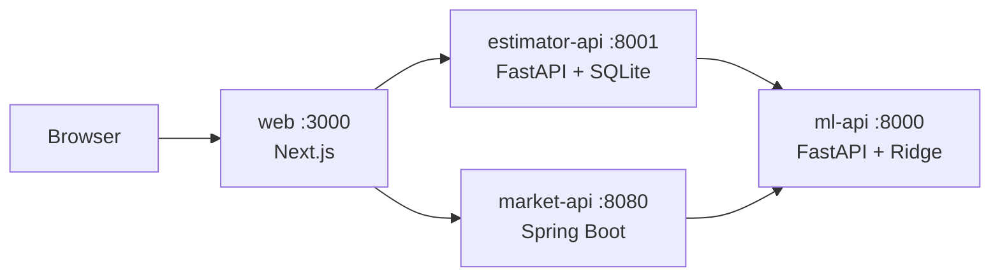

# Housing Prediction Portal

A small house-price platform: a scikit-learn model behind an API, an estimator service that stores estimates, a market-analytics service, and a Next.js portal on top.



## Quick start

```bash
docker compose up --build
```

| What | URL |
|---|---|
| Portal | http://localhost:3000 |
| ml-api Swagger | http://localhost:8000/docs |
| estimator-api Swagger | http://localhost:8001/docs |
| market-api Swagger | http://localhost:8080/swagger-ui.html |

The web image needs network at build time (`next/font/google`). Stop with `docker compose down` (estimates live in the `estimator-data` volume; add `-v` to wipe them).

## Local development

Tool versions are pinned in `mise.toml` (Python 3.14, uv, Java 21, Node 26).

```bash
mise install
mise tasks        # train, dev:ml, dev:estimator, dev:market, dev:web, lint:web, test, up, down
```

## Raspberry Pi deployment

Target: Raspberry Pi OS 64-bit (arm64), 4 GB RAM. Images are built natively on GitHub's arm64 runners and pulled from GHCR (`ghcr.io/ekhrapykin/hpp-<service>`).

1. **Docker** on the Pi:
   ```bash
   curl -fsSL https://get.docker.com | sh
   sudo usermod -aG docker $USER && newgrp docker
   uname -m   # aarch64
   ```
2. **Self-hosted runner**: repo **Settings -> Actions -> Runners -> New self-hosted runner -> Linux -> ARM64**. Run the shown commands on the Pi, add the label `pi` when asked, then install as a service:
   ```bash
   sudo ./svc.sh install && sudo ./svc.sh start
   ```
3. **Settings -> Actions -> General -> Fork pull request workflows**: enable "Require approval for outside collaborators". A self-hosted runner on a public repo must not run code from strangers (the deploy job only runs on `main` pushes, this is a second guard).
4. **GHCR visibility**: after the first push, make each `hpp-*` package public (GitHub profile -> Packages -> package -> Package settings -> Change visibility), so the Pi can pull without a login.
5. **Expose the portal** (only port 3000 is needed): Tailscale Funnel (`tailscale funnel 3000`) or a Cloudflare Tunnel pointing at `http://localhost:3000`.

Manual deploy, if needed: `docker compose pull && docker compose up -d --no-build`.

## CI/CD

`.github/workflows/ci-cd.yml`:

1. **Tests** (every push and PR): pytest for ml-api (after training) and estimator-api, `./gradlew test` for market-api, lint + `tsc` + `next build` for web.
2. **Build** (not on PRs): each service is built for `linux/arm64` on `ubuntu-24.04-arm` and pushed to GHCR as `latest` and the commit SHA.
3. **Deploy** (`main` only): the `pi` runner runs `docker compose pull`, `up -d --no-build --remove-orphans`, waits for all containers to be healthy, and prunes old images.

## Model notes

- Ridge regression on standardised features (`RidgeCV`, alphas 1e-3 to 1e3), evaluated with 5-fold cross-validation.
- The API returns warnings when an input falls outside the range seen in the training data (extrapolation).
- The features are strongly collinear (pairwise correlations 0.91 to 0.99), so individual coefficients are not identifiable and some have counter-intuitive signs. See `open_questions.md`.
