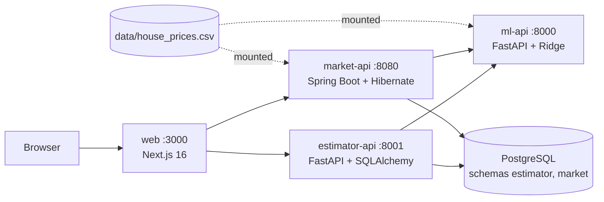

# Housing Prediction Portal

An interview take-home in one monorepo:

- **Task 1:** a scikit-learn housing-price model behind a FastAPI service (`ml-api`).
- **Task 2:** a Next.js portal (`web`) with two apps: a Price Estimator backed by a Python service (`estimator-api`) and a Market Explorer backed by a Java service (`market-api`).

Design and trade-offs: [ARCHITECTURE.md](ARCHITECTURE.md).



## Requirements map

| Requirement | Where it lives |
|---|---|
| Train a price model on the dataset | `ml-api/app/ml/train.py` (Ridge, 5-fold CV), run at ml-api startup from `data/house_prices.csv` |
| Prediction API: single and batch | `POST /predict`, `POST /predict/batch` in `ml-api/app/api/predictions.py` |
| Model insight | `GET /model-info`: coefficients, metrics, feature ranges |
| Input validation and out-of-range handling | Pydantic bounds (422) + extrapolation `warnings` in `ml-api/app/services/predictor.py` |
| Portal hosting both apps | `web/app/` with `/estimator` and `/market` |
| App 1, Python backend: estimate, history, compare | `estimator-api` (`/estimates` CRUD, SQLAlchemy on Postgres) + `web/app/estimator/*` |
| Per-feature price breakdown | `web/components/estimator/estimate-result.tsx` (coefficient x distance from mean) |
| App 2, Java backend: market analytics | `market-api` `/api/market/summary`, `/segments`, `/properties` + `web/app/market/*` |
| Filters, sorting, paging | JPA Specifications in market-api; URL-driven filters in the portal |
| What-if analysis | `POST /api/market/what-if` (market-api calls ml-api batch) + `web/app/market/what-if` |
| Export | `GET /api/market/export.csv`, `/export.pdf` |
| Tests | pytest (both Python services), JUnit (market-api), lint/tsc/build (web) |
| Containerisation and deployment | Dockerfiles, `docker-compose.yml`, `.github/workflows/ci-cd.yml`, Raspberry Pi runner |

## Quick start

```bash
docker compose up --build
```

| What | URL |
|---|---|
| Portal | http://localhost:3000 |
| ml-api Swagger | http://localhost:8000/docs |
| estimator-api Swagger | http://localhost:8001/docs |
| market-api Swagger | http://localhost:8080/swagger-ui.html |

The web image needs network at build time (`next/font/google`). Stop with `docker compose down`. Compose starts five services: `postgres` (one database, schemas `estimator` and `market`, one role each, no published port), `ml-api`, `estimator-api`, `market-api` and `web`. Estimates live in the `postgres-data` volume; add `-v` to wipe them. The dataset is the single file `data/house_prices.csv`, bind-mounted read-only into ml-api and market-api, so a data change needs only a restart. Optional: copy `.env.example` to `.env` to change the database passwords (they are read when the volume is first created).

## Local development

Tool versions are pinned in `mise.toml`: Python 3.14, uv, Java temurin-21, Node 26.

```bash
mise install
mise tasks
```

| Task | Does |
|---|---|
| `mise run train` | Optional: train the model and print metrics (ml-api itself trains at startup from `data/house_prices.csv`) |
| `mise run dev:ml` | ml-api on :8000 |
| `mise run dev:estimator` | estimator-api on :8001 |
| `mise run dev:market` | market-api on :8080 (`./gradlew bootRun`) |
| `mise run dev:web` | portal on :3000 |
| `mise run lint:web` | eslint + `tsc --noEmit` |
| `mise run test` | pytest in both Python services + `./gradlew test` |
| `mise run up` / `down` | docker compose up --build / down |

For `dev:web`, copy `web/.env.example` to `web/.env.local` so the portal points at `localhost`.

## Repository layout

| Path | What | Docs |
|---|---|---|
| `ml-api/` | Task 1 model API (Python) | [README](ml-api/README.md), [ARCHITECTURE](ml-api/ARCHITECTURE.md) |
| `estimator-api/` | Estimator backend (Python, SQLAlchemy) | [README](estimator-api/README.md), [ARCHITECTURE](estimator-api/ARCHITECTURE.md) |
| `market-api/` | Market backend (Java, Spring Boot) | [README](market-api/README.md), [ARCHITECTURE](market-api/ARCHITECTURE.md) |
| `web/` | Next.js portal | [README](web/README.md), [ARCHITECTURE](web/ARCHITECTURE.md) |
| `contracts/` | Shared contracts (house-feature JSON Schema, market query keys) and the error contract; each service has a test that compares its native schema with them | [README](contracts/README.md) |
| `data/` | The dataset (`house_prices.csv`, single copy) and sample inputs (`test_data.csv`) | |
| `postgres/init/` | Init script: roles and schemas, run on first start of the Postgres volume | |
| `.env.example` | Optional database password overrides | |
| `docker-compose.yml` | Full stack, images `ghcr.io/ekhrapykin/hpp-<service>:${TAG:-latest}` | |
| `.github/workflows/ci-cd.yml` | Test, build arm64 images, deploy to the Pi | |
| `mise.toml` | Toolchain and tasks | |

## Testing

```bash
mise run test                 # or per service:
cd ml-api && uv run pytest -q                                    # 7 tests (trains in lifespan)
cd estimator-api && uv run pytest -q                             # 6 tests
cd market-api && ./gradlew test                                  # JUnit 5 + Spring Test
cd web && npm run lint && npx tsc --noEmit                       # no unit tests in web
```

What each suite covers is listed in the service READMEs.

## Deployment (Raspberry Pi)

Target: Raspberry Pi OS 64-bit (arm64), 4 GB RAM. Images are built natively on GitHub's arm64 runners and pulled from GHCR.

1. **Docker** on the Pi: `curl -fsSL https://get.docker.com | sh`, then `sudo usermod -aG docker $USER && newgrp docker`. Check `uname -m` is `aarch64`.
2. **Self-hosted runner:** repo Settings -> Actions -> Runners -> New self-hosted runner -> Linux -> ARM64. Run the shown commands on the Pi, add the label `pi`, then `sudo ./svc.sh install && sudo ./svc.sh start`.
3. **Fork PR guard:** Settings -> Actions -> General -> enable "Require approval for outside collaborators". A self-hosted runner on a public repo must not run strangers' code (deploy only runs on `main` pushes; this is a second guard).
4. **GHCR visibility:** after the first push, make each `hpp-*` package public so the Pi can pull without a login.
5. **Expose the portal** (only port 3000): `tailscale funnel 3000`, or a Cloudflare Tunnel to `http://localhost:3000`.

Manual deploy, from a checkout of the repo (compose bind-mounts `./data` and `./postgres/init`): `docker compose pull && docker compose up -d --no-build`.

### CI/CD

`.github/workflows/ci-cd.yml`:

1. **Test** (every push and PR): pytest for ml-api (it trains in `lifespan` from the repo's CSV) and estimator-api (SQLite), `./gradlew test` for market-api (H2), lint + `tsc` + `next build` for web.
2. **Build** (not on PRs): each service built for `linux/arm64` on `ubuntu-24.04-arm`, pushed to GHCR as `latest` and the commit SHA.
3. **Deploy** (`main` only, `pi` runner): with `TAG` set to the commit SHA, `docker compose pull`, `up -d --no-build --remove-orphans`, wait until every container is healthy, prune old images. Roll back by running compose with `TAG=<older sha>`.

## Model notes

Ridge regression on standardised features (`Ridge`, alpha 10), 5-fold CV R2 about 0.97. Inputs outside the training range return warnings. The features are strongly collinear (pairwise correlation 0.91-0.99); see [ml-api/ARCHITECTURE.md](ml-api/ARCHITECTURE.md#data-notes). Model quality was deliberately not optimised; the task is architectural. α=10 is fixed so coefficients stay interpretable on collinear features; model selection is a future improvement.
