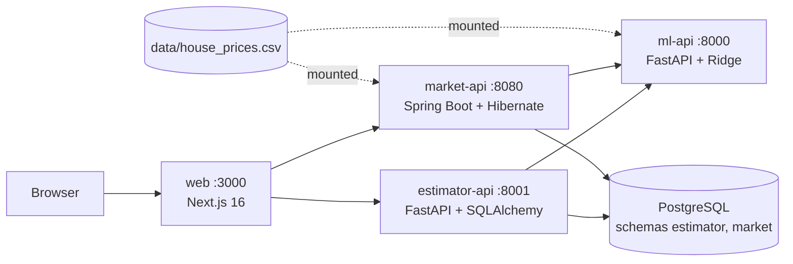

# Housing Prediction Portal

A house-price prediction platform in one monorepo: a scikit-learn model API (`ml-api`) and a Next.js portal (`web`) with two apps, a Price Estimator and a Market Explorer. Each app has its own backend (`estimator-api` in Python, `market-api` in Java), both store data in PostgreSQL and share one dataset, and CI/CD ships amd64 images to any Docker host.



## Features

**Model API (`ml-api`)**

- Ridge regression on standardised features (alpha 10, 5-fold CV R2 about 0.97), trained at startup from the shared CSV.
- Single and batch prediction, a model card with coefficients and metrics (`/model-info`), and warnings for inputs outside the training range.
- Pydantic validation, Swagger UI, health endpoint.

**Price Estimator (`/estimator`, backend `estimator-api`)**

- A form with every model field and client-side validation messages (react-hook-form + zod).
- Result as a table and a per-feature contribution chart, with out-of-range warnings.
- History of estimates and a side-by-side comparison of 2-4 of them.
- The backend validates, calls ml-api, and stores each estimate (SQLAlchemy on Postgres).

**Market Explorer (`/market`, backend `market-api`)**

- Interactive dashboard with segment charts and a price scatter, driven by eight filters that live in the URL, so every view is shareable.
- Sortable, filterable, paged properties table (sorting, filtering and paging run in market-api through JPA Specifications).
- What-if tool: vary one feature and see the model's price curve.
- CSV and PDF export of the filtered view.
- Caffeine cache on aggregates and what-if in market-api, and a Next.js data cache on the portal's market reads.

**Portal (`web`)**

- App Router with a shared layout and navigation, server components for initial data and TanStack Query for interactive state.
- Loading skeletons, route and global error boundaries, page transitions.
- Tailwind 4 and shadcn components, responsive layouts, basic accessibility measures (skip link, landmarks, labelled controls, `aria-live` errors, chart tables for screen readers).

**Platform**

- Rate limiting: estimator-api limits writes per client (429 with `Retry-After`), trusting `X-Forwarded-For` only from the portal.
- Request correlation: one `X-Request-ID` follows a request through the portal, every backend and the logs.
- Contracts: the house-feature schema and market query keys are defined once in `contracts/`, with a contract test in each service.
- Tests: pytest (both Python services), JUnit (market-api), vitest (web, including the contract check), and Playwright e2e against the compose stack.
- Docker Compose with PostgreSQL (one database, a schema and role per service) and one healthcheck definition.
- CI/CD: GitHub Actions tests, builds amd64 images, pushes to GHCR and deploys to a Docker host.

## Quick start

```bash
docker compose up --build
```

| What | URL |
|---|---|
| Portal | http://localhost:3000 |
| ml-api Swagger | http://localhost:8000/docs |
| estimator-api Swagger | http://localhost:8001/docs |
| market-api Swagger | http://localhost:8080/swagger-ui.html |

The web image needs network at build time (`next/font/google`). Stop with `docker compose down`. Compose starts five services: `postgres` (one database, schemas `estimator` and `market`, one role each, no published port), `ml-api`, `estimator-api`, `market-api` and `web`. Estimates live in the `postgres-data` volume; add `-v` to wipe them. The dataset is the single file `data/house_prices.csv`, bind-mounted read-only into ml-api and market-api, so a data change needs only a restart. Optional: copy `.env.example` to `.env` to change the host ports (`ML_API_PORT`, `ESTIMATOR_API_PORT`, `MARKET_API_PORT`, `WEB_PORT`; the URLs above assume the defaults) or the database passwords (read when the volume is first created).

## Local development

Tool versions are pinned in `mise.toml`: Python 3.14, uv, Java temurin-21, Node 26.

```bash
mise install
mise tasks
```

| Task | Does |
|---|---|
| `mise run dev:ml` | ml-api on :8000 (trains at startup from `data/house_prices.csv`) |
| `mise run dev:estimator` | estimator-api on :8001 |
| `mise run dev:market` | market-api on :8080 (`./gradlew bootRun`) |
| `mise run dev:web` | portal on :3000 |
| `mise run lint:web` | eslint + `tsc --noEmit` + vitest |
| `mise run test` | pytest in both Python services + `./gradlew test` |
| `mise run e2e` | Playwright against a running compose stack |
| `mise run up` / `down` | docker compose up --build / down |

`dev:web` defaults to `localhost:8001` and `localhost:8080` for the backends (set `ESTIMATOR_API_URL` / `MARKET_API_URL`, or copy `web/.env.example` to `web/.env.local`, to change that).

## Repository layout

| Path | What | Docs |
|---|---|---|
| `ml-api/` | Model API (Python) | [README](ml-api/README.md), [ARCHITECTURE](ml-api/ARCHITECTURE.md) |
| `estimator-api/` | Estimator backend (Python, SQLAlchemy) | [README](estimator-api/README.md), [ARCHITECTURE](estimator-api/ARCHITECTURE.md) |
| `market-api/` | Market backend (Java, Spring Boot) | [README](market-api/README.md), [ARCHITECTURE](market-api/ARCHITECTURE.md) |
| `web/` | Next.js portal | [README](web/README.md), [ARCHITECTURE](web/ARCHITECTURE.md) |
| `contracts/` | Shared schema contracts (house-feature JSON Schema, market query keys); each service has a test that compares its native schema with them | [README](contracts/README.md) |
| `data/` | The dataset (`house_prices.csv`, single copy), sample inputs (`test_data.csv`) and `postgres/init/` (roles and schemas, run on first start of the Postgres volume) | |
| `.env.example` | Optional overrides: database passwords and host ports | |
| `docker-compose.yml` | Full stack and the single healthcheck definition, images `ghcr.io/ekhrapykin/hpp-<service>:${TAG:-latest}` | |
| `.github/workflows/ci-cd.yml` | Test, build amd64 images, deploy to a Docker host | |
| `mise.toml` | Toolchain and tasks | |

## Testing

```bash
mise run test                 # or per service:
cd ml-api && uv run pytest -q
cd estimator-api && uv run pytest -q
cd market-api && ./gradlew test                                  # JUnit 5 + Spring Test
cd web && npm run lint && npx tsc --noEmit && npm test           # vitest
mise run e2e                  # Playwright against a running `docker compose up -d --build`
```

What each suite covers is listed in the service READMEs.

## Deployment

Target: any Docker host (VPS, home server, cloud VM), amd64 Linux. The compose memory limits are sized to fit a small 2-4 GB host. Images are built on GitHub's `ubuntu-latest` runners and pulled from GHCR. For an ARM host, switch `platforms` in the build job of `ci-cd.yml` and the runner.

1. **Docker** on the host: `curl -fsSL https://get.docker.com | sh`, then `sudo usermod -aG docker $USER && newgrp docker`. Check `uname -m` is `x86_64`.
2. **Self-hosted runner:** repo Settings -> Actions -> Runners -> New self-hosted runner -> Linux -> x64. Run the shown commands on the host, add the label `deploy`, then `sudo ./svc.sh install && sudo ./svc.sh start`.
3. **Fork PR guard:** Settings -> Actions -> General -> enable "Require approval for outside collaborators". A self-hosted runner on a public repo must not run strangers' code (deploy only runs on a manual run on `main`; this is a second guard).
4. **GHCR visibility:** after the first push, make each `hpp-*` package public so the host can pull without a login.
5. **Expose the portal** (only `WEB_PORT`, default 3000) through a reverse proxy (Caddy, nginx) or a tunnel (Cloudflare Tunnel to `http://localhost:3000`). The portal must sit behind a reverse proxy or tunnel that appends the client IP to `X-Forwarded-For` (nginx, Caddy, Traefik, Cloudflare and similar); exposing `web` directly lets a client pick its own rate-limit key. The backend ports are published for Swagger demos; firewall them or drop their `ports:` in compose.

Manual deploy, from a checkout of the repo (compose bind-mounts `./data/house_prices.csv` and `./data/postgres/init`): `docker compose pull && docker compose up -d --no-build`.

### CI/CD

`.github/workflows/ci-cd.yml`:

1. **Test** (every push and PR): pytest for ml-api (it trains in `lifespan` from the repo's CSV) and estimator-api (SQLite), `./gradlew test` for market-api (H2), lint + `tsc` + vitest + `next build` for web (Playwright e2e is local only).
2. **Build** (not on PRs): each service built for `linux/amd64` on `ubuntu-latest`, pushed to GHCR as `latest` and the commit SHA.
3. **Deploy** (manual only: Actions → ci-cd → Run workflow on `main`; a push never deploys; runner labelled `deploy`): with `TAG` set to the commit SHA, `docker compose pull`, `up -d --no-build --remove-orphans`, wait until every container is healthy (the healthchecks are defined once in `docker-compose.yml`), prune old images. Roll back by running compose with `TAG=<older sha>`.

## Further reading

- [ARCHITECTURE.md](ARCHITECTURE.md): system view, cross-cutting contracts, flows, caching, deployment, decisions, and [limitations and future work](ARCHITECTURE.md#limitations-and-future-work).
- Services: [ml-api](ml-api/README.md), [estimator-api](estimator-api/README.md), [market-api](market-api/README.md), [web](web/README.md), [contracts](contracts/README.md).
