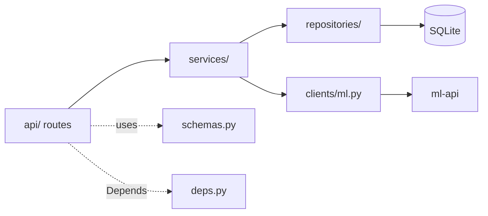
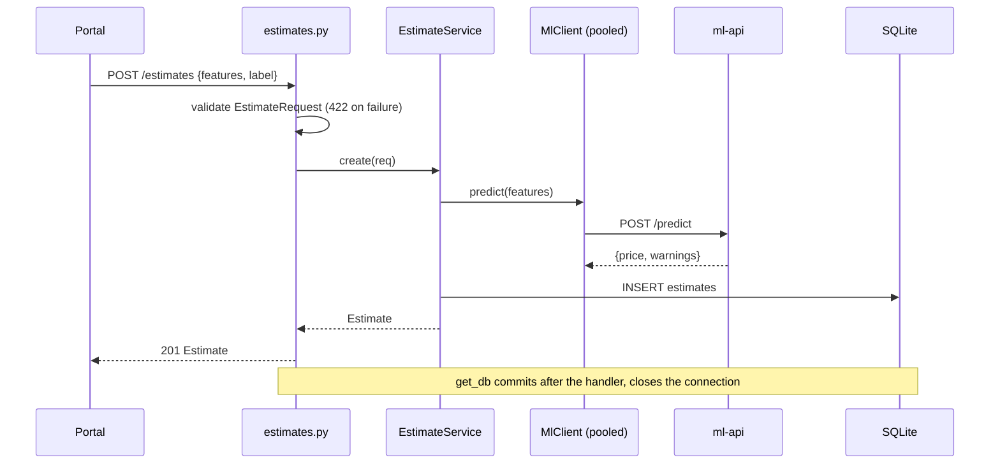

# estimator-api architecture

## Layers

| Layer | Module | Rule |
|---|---|---|
| Routes | `app/api/` | Declare path, status code and response model, delegate to a service. No SQL, no HTTP calls. |
| Service | `app/services/estimates.py` | Use cases (`create`, `get`, `list`, `delete`). Raises domain errors. No FastAPI imports. |
| Repository | `app/repositories/estimates.py` | The only place that writes SQL; maps rows to `Estimate`. Takes a connection. |
| Client | `app/clients/ml.py` | The only place that talks to ml-api; turns HTTP failures into domain errors. |
| Schemas | `app/schemas.py` | Request and response models. |
| Errors | `app/errors.py` | `AppError` hierarchy and one handler. |
| Config / deps | `config.py`, `deps.py`, `db.py` | Settings, wiring. `deps.py` is the composition root: it builds a service per request. |

Because the service takes plain collaborators, `test_estimate_service.py` runs it without FastAPI.

## Request flow: `POST /estimates`

The validated request is checked here and again by ml-api. A 422 from ml-api is passed through as a 422 rather than a 500.

## Errors

Every failure is rendered as `{"detail": ...}`, the same contract the other services use.

| Exception | Status | When |
|---|---|---|
| `NotFoundError` | 404 | unknown estimate id |
| `UpstreamValidationError` | 422 | ml-api answered 422; its `detail` is forwarded |
| `UpstreamError` | 502 | ml-api answered any other error status |
| `UpstreamUnavailable` | 503 | connect or timeout failure (any `httpx.HTTPError`) |
| FastAPI `RequestValidationError` | 422 | our own request validation; default body, `detail` is a list |

`app_error_handler` is registered for `AppError`, so adding an error is a subclass with a `status_code`. `MlClient._request` is the single translation point.

## Data and persistence

SQLite, stdlib `sqlite3`, one table:

`estimates(id INTEGER PK AUTOINCREMENT, label TEXT, features TEXT, price REAL, warnings TEXT, created_at TEXT)`

`features` and `warnings` are JSON text; `created_at` is an ISO-8601 UTC string. The table is created with `CREATE TABLE IF NOT EXISTS` in `lifespan`, so there are no migrations. Each request opens its own connection in `get_db` (`check_same_thread=False` because FastAPI may run the dependency and the sync handler on different threadpool threads), commits after the handler, and closes it. In Docker the file lives on the `estimator-data` volume.

## ml-api connection pool

`lifespan` creates one `httpx.Client(base_url, timeout)` and wraps it in `MlClient` on `app.state`. Connections are reused across requests and closed on shutdown. Per-call `is_healthy()` uses a 2 s timeout so `/health` never hangs for the full 5 s. Handlers are sync, so FastAPI's threadpool provides the concurrency and the sync client is fine.

## Testing seams

`conftest.py` overrides `get_ml_client` with `FakeMlClient` through `app.dependency_overrides` and points `DB_PATH` at a temp file (clearing the `lru_cache` on `get_settings`). The real stack runs in tests except the network call.

## Key decisions

| Decision | Why |
|---|---|
| Service owns ml-api calls, not the portal | Keeps the model private, persists every estimate with its warnings, one place for error mapping. |
| Raw `sqlite3`, no ORM | One table and five queries; an ORM would be more code than the problem. |
| JSON text columns | Features are always read and written as a unit; no querying inside them. |
| Connection per request | Avoids sharing a connection across threads. |
| Feature schema duplicated from ml-api | `ponytail` note in `schemas.py`: extract a shared package if a third consumer appears. Fails fast without a round-trip. |
| Domain error hierarchy | Services and clients stay HTTP-agnostic; one handler owns the wire format. |
| `/health` always 200 with `ml_api: up/down` | The service is alive even when its dependency is not; compose healthchecks stay stable. |

## Known limitations and next steps

- No authentication or per-user scoping: all clients share one history, and the portal never caches it (see the root [ARCHITECTURE.md](../ARCHITECTURE.md)).
- `ids` filter: invalid ids are silently dropped, an all-invalid list falls back to the recent list, and result order follows SQLite rather than the request.
- 422 `detail` is a list for validation errors but a string elsewhere; clients must handle both.
- The image runs as root (no `USER` in the Dockerfile).
- Single SQLite file means a single replica. A shared Postgres with one schema per service is the next step (root [ARCHITECTURE.md](../ARCHITECTURE.md)).
- The prediction inherits ml-api's collinearity caveat ([../ml-api/ARCHITECTURE.md](../ml-api/ARCHITECTURE.md)).
