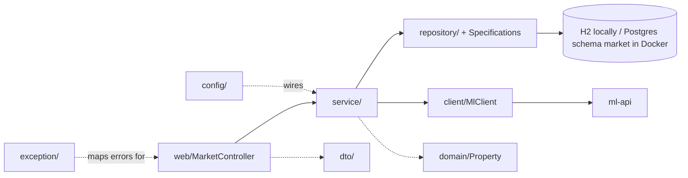
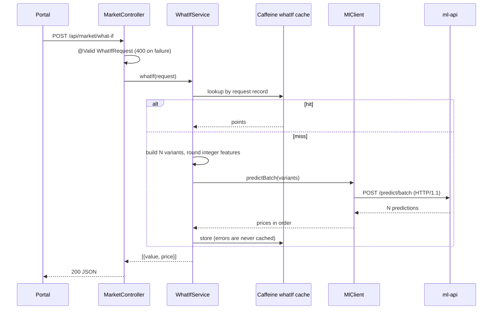

# market-api architecture

## Layers

| Layer | Package | Rule |
|---|---|---|
| Web | `web` | One `@RestController`. Binds and validates DTOs, delegates, sets download headers. No logic. |
| Service | `service` | Aggregation, paging/sort rules, what-if construction, export. Carries the `@Cacheable` annotations. |
| Repository | `repository` | `JpaRepository` + `JpaSpecificationExecutor`. `PropertySpecifications.from(MarketFilter)` turns the filter into a `Specification`. |
| Client | `client` | `MlClient`: the only code that calls ml-api; maps failures to `ApiException`s. |
| Domain | `domain` | `Property` entity. Never leaves the service layer; the controller returns `PropertyDto`. |
| DTO | `dto` | Java records: `MarketFilter`, `WhatIfRequest`, `HouseFeatures`, responses. Records give `equals`/`hashCode` for free, which makes them cache keys. |
| Config | `config` | `AppConfig` (caching, RestClient), `MlProperties`, `DataSeeder`. |
| Exception | `exception` | `ApiException` subclasses carry an HTTP status; `ApiExceptionHandler` renders them. |

## Request flow: `POST /what-if`

## Errors

`ApiExceptionHandler` extends `ResponseEntityExceptionHandler` and returns `ProblemDetail`, so every error has a `detail` string like the Python services (plus the standard `type`, `title`, `status`, `instance` fields).

| Exception | Status | Source |
|---|---|---|
| `BadRequestException` | 400 | unknown sort property or what-if feature; ml-api answered 400/422 |
| `NotFoundException` | 404 | defined, not used by current endpoints |
| `UpstreamErrorException` | 502 | ml-api 5xx or a malformed/mismatched response |
| `UpstreamUnavailableException` | 503 | connect/read timeout or connection failure |
| `MethodArgumentNotValidException` | 400 | request-body validation; `detail` is `field message; ...` |
| Spring MVC defaults | 400 | bad `by` enum, missing parameter, type mismatch (via the base class) |

Validation failures are 400 here and 422 in the Python services; the portal treats any non-2xx `detail` the same way.

## Data and persistence

- `DataSeeder` (an `ApplicationRunner`) reads the file at `data.path` (`DATA_PATH`; default `../data/house_prices.csv`, `/data/house_prices.csv` in Docker, where the repo's `data/` is bind-mounted read-only), strips the UTF-8 BOM and saves 50 `Property` rows. The same file feeds ml-api training; there is one copy in the repo.
- Default config is H2 in-memory (`jdbc:h2:mem:market`, `create-drop`), so `bootRun` and the tests need no database. The `docker` profile (`application-docker.yml`) points at the shared Postgres as role `market` with `hibernate.default_schema=market`, and uses `ddl-auto: create`: Hibernate drops and recreates the table at startup, with no migrations.
- Reseeding is idempotent: the seeder runs `deleteAllInBatch()` before inserting, so a restart never duplicates rows (and rows removed from the CSV disappear). Nothing survives a restart on purpose: it is reference data nobody writes.
- `open-in-view` is off; services open their own transactions through the repository.
- Filtering is a JPA `Specification` (`Specification.allOf` over the non-null filters), shared by summary, segments, paging and exports. Sort keys are checked against a whitelist (`SORTABLE`) and snake_case is converted to the entity's camelCase.
- Aggregates (summary, segments) are computed in Java over the filtered list (`ponytail` note in `MarketService`); with 50 rows that is simpler than JPQL aggregates.

## Caching

`@EnableCaching` with Caffeine, one spec for all caches: `maximumSize=500,expireAfterWrite=10m`.

| Cache | Method | Key |
|---|---|---|
| `summary` | `MarketService.summary` | `MarketFilter` record |
| `segments` | `MarketService.segments` | `(MarketFilter, Segment)` |
| `whatIf` | `WhatIfService.whatIf` | `WhatIfRequest` record (includes the base house) |

Value-based record keys mean two requests with the same parameters hit the same entry with no key-building code. The data is immutable after startup, so entries are only evicted by size or age; for `whatIf`, age bounds how stale a result can be if ml-api is retrained. Paging and exports are not cached. `ExportService.pdf` calls `market.summary` through the Spring proxy, so it reuses the `summary` cache. Failed what-if calls throw and are therefore not cached.

## ml-api client

`MlClient` uses a Spring `RestClient` built in `AppConfig` on the JDK `HttpClient` with timeouts of 2 s (connect) and 5 s (read). It is forced to HTTP/1.1: the JDK client defaults to attempting an h2c upgrade on cleartext connections and uvicorn rejects that request. It sends one `POST /predict/batch` per what-if and checks that the response has one prediction per input, in order.

## Exports

`ExportService` writes CSV by hand (all columns numeric, no quoting needed) and PDF with OpenPDF: a title, the summary line, and a table of all filtered rows on A4 landscape. Both are built in memory and returned as `byte[]` with `Content-Disposition: attachment`.

## Key decisions

| Decision | Why |
|---|---|
| Java 21 | An LTS inside Boot 3.4's supported range (up to Java 24) that also runs on Gradle 8; JDK 25 would need Gradle 9. 21 avoids that toolchain upgrade. |
| Gradle Kotlin DSL + version catalog | Typed build script; versions of non-BOM libraries in one file. Configuration cache and build cache are on in `gradle.properties`. |
| H2 locally, Postgres in Docker; both seeded from the mounted CSV | The same JPA code runs on both. H2 keeps `bootRun` and the tests dependency-free; Postgres matches the deployment. `create` plus a reseed is enough for 50 reference rows. |
| JPA Specifications | One composable filter definition for four endpoints, no string-built queries. |
| Records as cache keys | Immutable, value-based `equals`/`hashCode`. |
| RestClient forced to HTTP/1.1 | Avoids the h2c upgrade uvicorn rejects. |
| `ProblemDetail` with `detail` | Spring's native error type, and it satisfies the cross-service `{detail}` contract. |
| Virtual threads | Request threads are cheap while blocked on ml-api. |
| Bounds mirrored in `HouseFeatures` | Fails fast with a 400 before spending a round-trip. |

## Known limitations and next steps

- In-memory aggregates and `findAll` for exports do not scale past a small dataset; push aggregation into JPQL or SQL and stream exports.
- The CSV is duplicated with ml-api. A shared read-only `housing` schema would remove the copy (root [ARCHITECTURE.md](../ARCHITECTURE.md)).
- No tests for exports or cache behaviour; no test hits a real ml-api.
- Validation errors from nested objects report Java field paths (for example `base.squareFootage`) rather than snake_case names.
- What-if curves inherit ml-api's collinearity problem: because the model's coefficients are unstable, the price can slope down as square footage rises ([../ml-api/ARCHITECTURE.md](../ml-api/ARCHITECTURE.md)).
- `NotFoundException` is unused.
