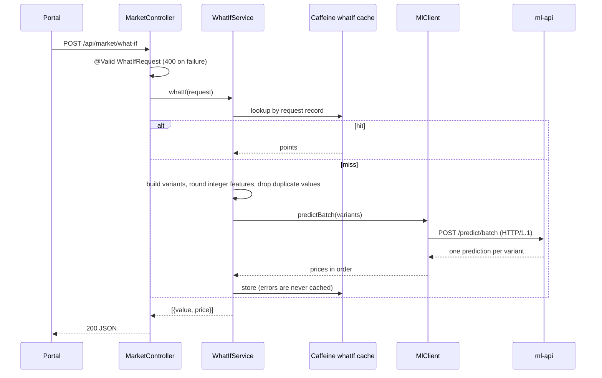

# market-api architecture

## Layers

| Layer | Package | Rule |
|---|---|---|
| API | `api` | One `@RestController`. Binds and validates DTOs, delegates, sets download headers. No logic. |
| Service | `service` | Aggregation, paging/sort rules, what-if construction, export. Carries the `@Cacheable` annotations. |
| Repository | `repository` | `JpaRepository` + `JpaSpecificationExecutor`. `PropertySpecifications.from(MarketFilter)` turns the filter into a `Specification`. |
| Client | `client` | `MlClient`: the only code that calls ml-api; maps failures to `ResponseStatusException`s. |
| Domain | `domain` | `Property` entity. Never leaves the service layer; the controller returns `PropertyDto`. |
| DTO | `dto` | Java records: `MarketFilter`, `WhatIfRequest`, `HouseFeatures`, responses. Records give `equals`/`hashCode` for free, which makes them cache keys. |
| Config | `config` | `AppConfig` (caching, RestClient), `MlProperties`. |
| Ingest | `ingest` | `CsvPropertySync`: reloads the market table from the dataset file on start. |
| Exception | `exception` | services throw `ResponseStatusException` (carries the HTTP status); `ApiExceptionHandler` adds the validation-error rendering. |

## Request flow: `POST /what-if`

## Errors

`ApiExceptionHandler` extends `ResponseEntityExceptionHandler` and returns `ProblemDetail`, so every error has a `detail` string like the Python services (plus the standard `type`, `title`, `status`, `instance` fields).

| Exception | Status | Source |
|---|---|---|
| `ResponseStatusException` | 400 | unknown sort property or what-if feature; ml-api answered 400/422 (its `detail` is passed through, see below) |
| `ResponseStatusException` | 502 | ml-api 5xx or a malformed/mismatched response |
| `ResponseStatusException` | 503 | connect/read timeout or connection failure |
| `MethodArgumentNotValidException` | 400 | request-body validation; `detail` is `field message; ...`, field paths in snake_case (`base.square_footage`, converted with Jackson's `SNAKE_CASE` strategy). `from >= to` is an `@AssertTrue` on `WhatIfRequest`, reported as just `"from" must be less than "to"` (cross-field `@AssertTrue` rules print their message without a field prefix) |
| Spring MVC defaults | 400 | bad `by` enum, missing parameter, type mismatch (via the base class) |

**ml-api rejections.** `MlClient` parses FastAPI's body: a 422 `{"detail":[{"loc":[...],"msg":"..."}]}` becomes a 400 whose detail is `<last loc element>: <msg>` joined with `; ` (e.g. `year_built: Input should be greater than or equal to 1800`); a 400 string `detail` passes through as is. If the body can't be parsed it falls back to `Prediction service rejected the input`. This is why the Java side keeps no second copy of the feature bounds for the varied range. Other 4xx/5xx from ml-api are 502; unreachable is 503.

**What-if dedup.** Integer features (`bedrooms`, `year_built`) are rounded per step, so many steps can land on the same value (bedrooms 1 to 3 in 50 steps). Duplicates are dropped (first occurrence, order kept) and ml-api is sent only the distinct variants, so the curve has no repeated x values and may have fewer than `steps` points.

Validation failures are 400 here and 422 in the Python services; the portal treats any non-2xx `detail` the same way.

## Request id

`RequestIdFilter` (`config/`, `OncePerRequestFilter`, highest precedence) accepts a valid `X-Request-ID` (`^[A-Za-z0-9-]{1,64}$`) or generates a UUID4, puts it in the MDC as `requestId`, sets the response header, logs one line per request (method, path, status, ms, like the Python services) and clears the MDC in `finally`. `logging.pattern.level` prints it as `[req=...]`. `RequestIdInterceptor` on the ml-api `RestClient` copies it from the MDC to the outgoing call. Virtual threads are on, but a request runs start to finish on one thread and the ml-api call is made synchronously on it, so the thread-bound MDC is visible to the interceptor. If code ever hands work to another thread, it must copy the MDC itself.

There is no rate limit on what-if: the Caffeine cache and the `steps` cap (at most 50) bound its cost.

## Data and persistence

- `CsvPropertySync` (an `ApplicationRunner`) reads the file at `data.path` (`DATA_PATH`; default `../data/house_prices.csv`, `/data/house_prices.csv` in Docker, where the repo's `data/` is bind-mounted read-only), strips the UTF-8 BOM and saves 50 `Property` rows. The same file feeds ml-api training; there is one copy in the repo.
- Default config is H2 in-memory (`jdbc:h2:mem:market`, `create-drop`), so `bootRun` and the tests need no database. The `docker` profile (`application-docker.yml`) points at the shared Postgres as role `market` with `hibernate.default_schema=market`, and uses `ddl-auto: create`: Hibernate drops and recreates the table at startup, with no migrations.
- **It is a sync, not a one-off seed.** The CSV is the source of truth and ml-api trains from the same file, so the `market` table is a read model derived from it. Reloading on every start keeps the dashboard and the model on the same data after the file changes (new data = restart, no migration), and it is what fills the in-memory H2 in dev and tests. The reload is a full replace (`deleteAllInBatch()` then `saveAll`), so it is idempotent: a restart never duplicates rows, and rows removed from the CSV disappear. It costs milliseconds for 50 rows.
- Alternatives considered: a Postgres init script (`COPY ... FROM`) runs only when the volume is first created, so CSV updates would never arrive, and H2 would still need its own loader; a Flyway seed migration is the right tool once data is owned by migrations, but every CSV change would need a new migration; a one-shot `market-seed` container adds an image and startup ordering for 50 rows.
- `market.sync-on-startup` (`MARKET_SYNC_ON_STARTUP`, default `true`) turns the sync off without a code change, for when Flyway takes over (see [Limitations and future work](../ARCHITECTURE.md#limitations-and-future-work)).
- `open-in-view` is off; services open their own transactions through the repository.
- Filtering is a JPA `Specification` (`Specification.allOf` over the non-null filters), shared by summary, segments, paging and exports. Sort keys are checked against a whitelist (`SORTABLE`) and snake_case is converted to the entity's camelCase.
- Aggregates (summary, segments) are computed in Java over the filtered list (`ponytail` note in `MarketService`); with 50 rows that is simpler than JPQL aggregates.

## Caching

`@EnableCaching` with Caffeine, one spec for all caches: `maximumSize=500,expireAfterWrite=10m`.

| Cache | Method | Key |
|---|---|---|
| `summary` | `MarketService.summary` | `MarketFilter` record |
| `segments` | `MarketService.segments` | `(MarketFilter, Segment)` |
| `whatIf` | `WhatIfService.whatIf` | `WhatIfRequest` record (includes the base house) |

Value-based record keys mean two requests with the same parameters hit the same entry with no key-building code. The data is immutable after startup, so entries are only evicted by size or age; for `whatIf`, age bounds how stale a result can be if ml-api is retrained. Paging and exports are not cached. `ExportService.pdf` calls `market.summary` through the Spring proxy, so it reuses the `summary` cache. Failed what-if calls throw and are therefore not cached.

## ml-api client

`MlClient` uses a Spring `RestClient` built in `AppConfig` on the JDK `HttpClient` with timeouts from `MlProperties` (`ml.api.connect-timeout` 2 s, `ml.api.read-timeout` 5 s by default). It is forced to HTTP/1.1: the JDK client defaults to attempting an h2c upgrade on cleartext connections and uvicorn rejects that request. It sends one `POST /predict/batch` per what-if and checks that the response has one prediction per input, in order.

## Exports

`ExportService` writes CSV by hand (all columns numeric, no quoting needed) and PDF with OpenPDF: a title, the summary line, and a table of all filtered rows on A4 landscape. Both are built in memory and returned as `byte[]` with `Content-Disposition: attachment`.

## Key decisions

| Decision | Why |
|---|---|
| Java 21 | An LTS inside Boot 3.4's supported range (up to Java 24) that also runs on Gradle 8; JDK 25 would need Gradle 9. 21 avoids that toolchain upgrade. |
| Gradle Kotlin DSL + version catalog | Typed build script; versions of non-BOM libraries in one file. Configuration cache and build cache are on in `gradle.properties`. |
| H2 locally, Postgres in Docker; both synced from the mounted CSV on start | The same JPA code runs on both. H2 keeps `bootRun` and the tests dependency-free; Postgres matches the deployment. `create` plus a reseed is enough for 50 reference rows. |
| JPA Specifications | One composable filter definition for four endpoints, no string-built queries. |
| Records as cache keys | Immutable, value-based `equals`/`hashCode`. |
| RestClient forced to HTTP/1.1 | Avoids the h2c upgrade uvicorn rejects. |
| `ProblemDetail` with `detail` | Spring's native error type, and it satisfies the cross-service `{detail}` contract. |
| Virtual threads | Request threads are cheap while blocked on ml-api. |
| Bounds mirrored in `HouseFeatures` | Fails fast with a 400 before spending a round-trip. `ContractTest` checks them against `contracts/house-features.schema.json`. |

## Limitations

- Tests do not cover exports, cache behaviour, or the HTTP/1.1 client against a live ml-api (uvicorn).
- The request id lives in the thread-bound MDC; code that hands work to another thread must copy it.

System-wide items (in-memory aggregates, dataset loaded twice, migrations): [Limitations and future work](../ARCHITECTURE.md#limitations-and-future-work).
