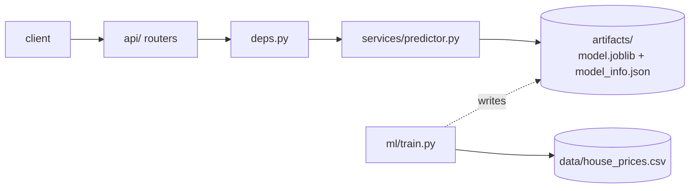
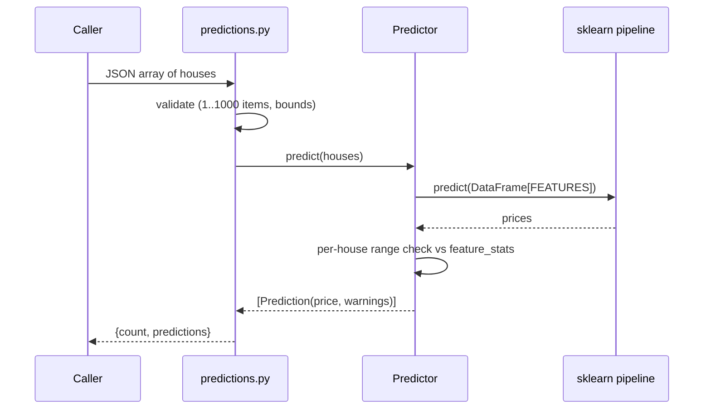

# ml-api architecture

## Layers

| Layer | Module | Rule |
|---|---|---|
| Routes | `app/api/*.py` | HTTP only: parse, call the predictor, return. No ML code. |
| Schemas | `app/schemas.py` | Pydantic validation and bounds. The only definition of the request contract. |
| Service | `app/services/predictor.py` | `Predictor` wraps the fitted pipeline and the model card; builds the DataFrame, predicts, computes warnings. Knows nothing about HTTP. |
| Deps | `app/deps.py` | Hands the predictor from `app.state` to routes (`PredictorDep`). |
| Config | `app/config.py` | `Settings` via pydantic-settings, cached with `lru_cache`. |
| ML | `app/ml/` | `features.py` is the single list of feature names and the target; `train.py` is an offline script, never imported by the API. |

There is no repository layer: the "data store" is two read-only files.

## Request flow: `POST /predict/batch`

## Model and training

`python -m app.ml.train` does the following:

1. Reads the CSV with `encoding="utf-8-sig"` (the file starts with a BOM).
2. Builds `make_pipeline(StandardScaler(), RidgeCV(alphas=logspace(-3, 3, 25)))`.
3. Runs 5-fold CV (`KFold(shuffle=True, random_state=42)`) for R2, RMSE, MAE, then fits on all 50 rows.
4. Writes `model.joblib` and `model_info.json`.

`model_info.json` holds two views of the coefficients. `coefficients` are in raw units (`ridge.coef_ / scaler.scale_`, with the intercept shifted to match), which the portal multiplies by `(value - mean)` for the per-feature breakdown. `standardized_coefficients` are per standard deviation and comparable across features. It also stores CV and train metrics and `feature_stats`, which the API reuses for warnings and the portal for default ranges.

Last local run: alpha 0.32, CV R2 0.984, CV RMSE about 9.6k, CV MAE about 7.5k.

## Lifespan and statelessness

`lifespan` loads the `Predictor` once into `app.state.predictor`. Requests share a read-only model, so there is no locking and no per-request disk I/O. If the artifacts are missing, startup fails loudly rather than serving 500s. `GET /health` reports `model_loaded`, which is always true once the app is up.

## Errors

ml-api registers no custom handler. FastAPI's default 422 body is `{"detail": [ {loc, msg, type, ...} ]}` (a list, not a string). `estimator-api` and `market-api` translate that into their own `{detail}` contract; see [../estimator-api/ARCHITECTURE.md](../estimator-api/ARCHITECTURE.md) and [../market-api/ARCHITECTURE.md](../market-api/ARCHITECTURE.md). Out-of-range values are not errors; they come back as `warnings`.

## Data and persistence

None at runtime. Training data is baked into the image next to the code; `artifacts/` is git-ignored locally and produced by the Docker build in deployment.

## Key decisions

| Decision | Why |
|---|---|
| Train at Docker build time | The image is self-contained and reproducible; no volume or init job. Cost: retraining means rebuilding. |
| Ridge on standardised features | The features are collinear (pairwise correlation 0.91-0.99); regularisation keeps the fit stable, scaling makes alpha meaningful. |
| `RidgeCV` picks alpha | One less hand-tuned knob. See limitations for the downside. |
| CV metrics reported, plus train metrics | 50 rows: train metrics alone would flatter the model. |
| Raw and standardised coefficients | Raw for price-per-unit explanations, standardised for importance. |
| Warn, don't reject, on extrapolation | A caller can still get a number, and knows how much to trust it. Hard bounds in the schema only stop nonsense. |
| `Predictor` in `app.state` via `lifespan` | Load once, inject through `Depends`, easy to fake in tests. |
| Sync route handlers | sklearn is CPU-bound and blocking; FastAPI runs sync handlers in a threadpool. |

## Known limitations and next steps

- **Unstable coefficients.** The features are highly collinear, so individual coefficients are not identifiable and some have implausible signs: with the current fit `square_footage`, `bedrooms` and `year_built` are negative and `distance_to_city_center` is positive. Predictions are good (CV R2 about 0.98) but one-feature-at-a-time questions are not. The what-if curve in the portal can slope down with square footage because of this. A larger fixed alpha trades a little R2 for sensible signs; adding VIF to `/model-info` would document the problem.
- 50 training rows; the CV estimate is noisy and there is no held-out test set.
- No model versioning: `trained_at` is the only identifier.
- Next step: train from a shared database through a one-shot job instead of a CSV in the image (see the root [ARCHITECTURE.md](../ARCHITECTURE.md)).
