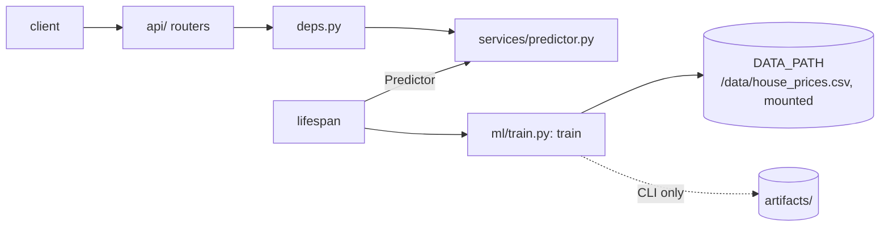
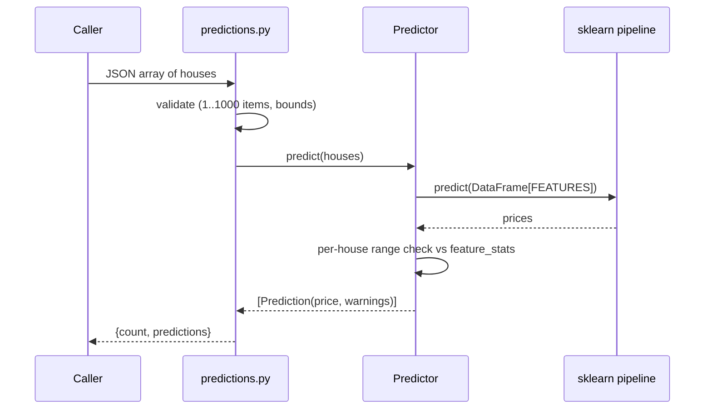

# ml-api architecture

## Layers

| Layer | Module | Rule |
|---|---|---|
| Routes | `app/api/*.py` | HTTP only: parse, call the predictor, return. No ML code. |
| Schemas | `app/schemas.py` | Pydantic validation and bounds. The service's own definition of the request contract; `tests/test_contract.py` pins it to `contracts/house-features.schema.json`. |
| Service | `app/services/predictor.py` | `Predictor` wraps the fitted pipeline and the model card; builds the DataFrame, predicts, computes warnings. Knows nothing about HTTP. |
| Deps | `app/deps.py` | Hands the predictor from `app.state` to routes (`PredictorDep`). |
| Config | `app/config.py` | `Settings` via pydantic-settings, cached with `lru_cache`. |
| ML | `app/ml/` | `features.py` is the single list of feature names and the target; `train.py` has `train(data_path)`, which `lifespan` calls at startup, and a CLI `main()` for local use. |

There is no repository layer: the only input is one read-only CSV.

## Request flow: `POST /predict/batch`

## Model and training

`train(data_path, alpha)` (called by `lifespan`; `python -m app.ml.train` wraps it for local use) does the following:

1. Reads the CSV with `encoding="utf-8-sig"` (the file starts with a BOM).
2. Builds `make_pipeline(StandardScaler(), Ridge(alpha=settings.model_alpha))`.
3. Runs 5-fold CV (`KFold(CV_FOLDS, shuffle=True, random_state=CV_RANDOM_STATE)`) for R2, RMSE, MAE, then fits on all 50 rows.
4. Returns the fitted pipeline and the model card. Only the CLI writes `model.joblib` and `model_info.json`; the service keeps both in memory.

The model card (served at `/model-info`) holds two views of the coefficients. `coefficients` are in raw units (`ridge.coef_ / scaler.scale_`, with the intercept shifted to match), which the portal multiplies by `(value - mean)` for the per-feature breakdown. `standardized_coefficients` are per standard deviation and comparable across features. It also stores CV and train metrics and `feature_stats`, which the API reuses for warnings and the portal for default ranges.

The CV split uses a fixed seed, so every start gives the same metrics. Last local run (alpha 10): CV R2 0.973, CV RMSE about 12.2k, CV MAE about 10.9k. Raw coefficients are all positive (about +$24 per sq ft, +$9.7k per bedroom).

Model quality was deliberately not optimised; the task is architectural. α=10 is fixed so coefficients stay interpretable on collinear features; model selection is a future improvement. Alpha comes from `Settings.model_alpha` (env `MODEL_ALPHA`, default 10.0).

## Lifespan and statelessness

`lifespan` trains once at startup (about a second on 50 rows) and puts the `Predictor` into `app.state.predictor`. Requests share a read-only model, so there is no locking and no per-request disk I/O. If the CSV is missing or malformed, startup fails loudly rather than serving 500s. Compose gives the healthcheck a 30 s start period for this. `GET /health` reports `model_loaded`, which is always true once the app is up.

## Errors

ml-api registers no custom handler. FastAPI's default 422 body is `{"detail": [ {loc, msg, type, ...} ]}` (a list, not a string). `estimator-api` and `market-api` translate that into their own `{detail}` contract; see [../estimator-api/ARCHITECTURE.md](../estimator-api/ARCHITECTURE.md) and [../market-api/ARCHITECTURE.md](../market-api/ARCHITECTURE.md). Out-of-range values are not errors; they come back as `warnings`.

## Request id and logs

`RequestIdMiddleware` (`app/request_id.py`, pure ASGI) takes a valid `X-Request-ID` from the caller or generates a UUID4, keeps it in a `ContextVar`, sets it on the response and logs one line per request. A log `Filter` adds it to every record (`[req=%(request_id)s]`, `-` outside a request). Uvicorn's access log is disabled in favour of the middleware line. The file is identical in estimator-api.

## Data and persistence

No database. The training CSV is the single copy at the repo root (`data/house_prices.csv`), bind-mounted read-only at `/data` in Docker and read via `DATA_PATH`. Nothing is written at runtime; `artifacts/` is only produced by the optional CLI and is git-ignored.

## Key decisions

| Decision | Why |
|---|---|
| Train at startup from the mounted CSV | One dataset copy shared with market-api, a data change needs only a restart (no rebuild), and training is deterministic. Cost: a few seconds of startup, and the image alone is not a model. |
| Ridge on standardised features | The features are collinear (pairwise correlation 0.91-0.99); regularisation keeps the fit stable, scaling makes alpha meaningful. |
| Fixed `Ridge(alpha=10)` | A cross-validated alpha on 50 collinear rows came out tiny and gave negative coefficients for square footage, bedrooms and year built. A fixed, larger alpha costs about 0.01 of CV R2 and keeps the breakdown interpretable. Configurable via `MODEL_ALPHA`. |
| CV metrics reported, plus train metrics | 50 rows: train metrics alone would flatter the model. |
| Raw and standardised coefficients | Raw for price-per-unit explanations, standardised for importance. |
| Warn, don't reject, on extrapolation | A caller can still get a number, and knows how much to trust it. Hard bounds in the schema only stop nonsense. |
| `Predictor` in `app.state` via `lifespan` | Load once, inject through `Depends`, easy to fake in tests. |
| Sync route handlers | sklearn is CPU-bound and blocking; FastAPI runs sync handlers in a threadpool. |

## Known limitations and next steps

- **Collinear features.** Coefficients of single features are not individually identifiable (see Data notes), so read them as "holding the others fixed" effects, not causal ones. Alpha is fixed rather than selected; model selection is a future improvement. Adding VIF to `/model-info` would document the problem.
- 50 training rows; the CV estimate is noisy and there is no held-out test set.
- No model versioning: `trained_at` is the only identifier.
- Retraining needs a restart; an admin endpoint that retrains and swaps the model safely is listed under future improvements in the root [ARCHITECTURE.md](../ARCHITECTURE.md).

## Data notes

- 50 rows, no nulls or duplicates.
- Price per sq ft sits between $141 and $173.
- One influential point (id=3, Cook's D 2.68), but removing it, or the top 3, does not fix the coefficient signs.
- VIF: square_footage 212, lot_size 150, year_built 88, distance 69, school_rating 49, bathrooms 24, bedrooms 14.
- So the cause is collinearity, not bad records, and no rows were removed.
- `distance_to_city_center` correlates 0.99 with price (a data quirk: farther = pricier).
