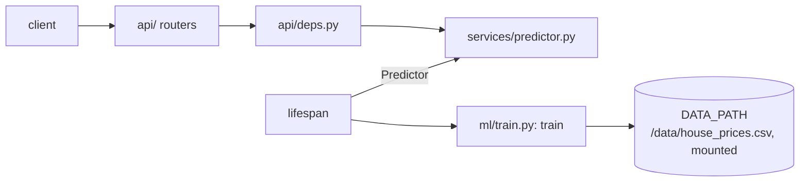
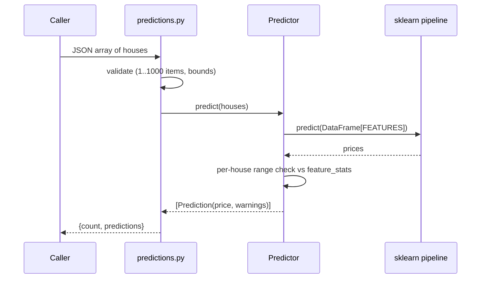

# ml-api architecture

## Layers

| Layer | Module | Rule |
|---|---|---|
| Routes | `app/api/*.py` | HTTP only: parse, call the predictor, return. No ML code. |
| Schemas | `app/schemas.py` | Pydantic validation and bounds. The service's own definition of the request contract; `tests/test_contract.py` pins it to `contracts/house-features.schema.json`. |
| Service | `app/services/predictor.py` | `Predictor` wraps the fitted pipeline and the model card; builds the DataFrame, predicts, computes warnings. Knows nothing about HTTP. |
| Deps | `app/api/deps.py` | Hands the predictor from `app.state` to routes (`PredictorDep`). |
| Core | `app/core/config.py`, `app/core/logging.py` | `Settings` via pydantic-settings, cached with `lru_cache`; request-id and access-log setup. Imports nothing from the other layers. |
| ML | `app/ml/` | `train.py` has `train(data_path)`, which `lifespan` calls at startup, plus the feature list (derived from `HouseFeatures`) and the target. |

There is no repository layer: the only input is one read-only CSV.

## Request flow: `POST /predict/batch`

## Model and training

`train(data_path, alpha)` (called by `lifespan`) does the following:

1. Reads the CSV with `encoding="utf-8-sig"` (the file starts with a BOM).
2. Builds `make_pipeline(StandardScaler(), Ridge(alpha=settings.model_alpha))`.
3. Runs 5-fold CV (`KFold(CV_FOLDS, shuffle=True, random_state=CV_RANDOM_STATE)`) for R2, RMSE, MAE, then fits on all 50 rows.
4. Returns the fitted pipeline and the model card. The service keeps both in memory.

The model card (served at `/model-info`) holds two views of the coefficients. `coefficients` are in raw units (`ridge.coef_ / scaler.scale_`, with the intercept shifted to match), which the portal multiplies by `(value - mean)` for the per-feature breakdown. `standardized_coefficients` are per standard deviation and comparable across features. It also stores CV and train metrics and `feature_stats`, which the API reuses for warnings and the portal for default ranges.

The CV split uses a fixed seed, so every start gives the same metrics. Last local run (alpha 10): CV R2 0.973, CV RMSE about 12.2k, CV MAE about 10.9k. Raw coefficients are all positive (about +$24 per sq ft, +$9.7k per bedroom).

Model quality is not the focus: the project is about the service architecture around the model; α=10 is fixed so coefficients stay interpretable on collinear features. Alpha comes from `Settings.model_alpha` (env `MODEL_ALPHA`, default 10.0).

## Lifespan and statelessness

`lifespan` trains once at startup (about a second on 50 rows) and puts the `Predictor` into `app.state.predictor`. Requests share a read-only model, so there is no locking and no per-request disk I/O. If the CSV is missing or malformed, startup fails loudly rather than serving 500s. Compose gives the healthcheck a 30 s start period for this. `GET /health` is therefore a plain `{"status":"ok"}`.

## Errors

ml-api registers no custom handler. FastAPI's default 422 body is `{"detail": [ {loc, msg, type, ...} ]}` (a list, not a string). `estimator-api` and `market-api` translate that into their own `{detail}` contract; see [../estimator-api/ARCHITECTURE.md](../estimator-api/ARCHITECTURE.md) and [../market-api/ARCHITECTURE.md](../market-api/ARCHITECTURE.md). Out-of-range values are not errors; they come back as `warnings`.

## Request id and logs

`asgi-correlation-id`'s `CorrelationIdMiddleware` (wired in `app/core/logging.py`) takes an `X-Request-ID` from the caller if it matches `^[A-Za-z0-9-]{1,64}$` (our `validator`) or generates a UUID4, keeps it in `correlation_id`, and echoes it in the response. The library's `CorrelationIdFilter` adds it to every record (`[req=%(correlation_id)s]`, `-` outside a request). A tiny pure-ASGI `AccessLogMiddleware`, added first so it runs inside the correlation one, logs `METHOD path -> status (ms)` and skips `/health`. Uvicorn's access log is disabled in favour of it. `app/core/logging.py` is identical in estimator-api.

## Data and persistence

No database. The training CSV is the single copy at the repo root (`data/house_prices.csv`), bind-mounted read-only at `/data` in Docker and read via `DATA_PATH`. Nothing is written at runtime.

## Key decisions

| Decision | Why |
|---|---|
| Train at startup from the mounted CSV | One dataset copy shared with market-api, a data change needs only a restart (no rebuild), and training is deterministic. Cost: a few seconds of startup, and the image alone is not a model. |
| Ridge on standardised features | The features are collinear (pairwise correlation 0.91-0.99); regularisation keeps the fit stable, scaling makes alpha meaningful. |
| Fixed `Ridge(alpha=10)` | A cross-validated alpha on 50 collinear rows came out tiny and gave negative coefficients for square footage, bedrooms and year built. A fixed, larger alpha costs about 0.01 of CV R2 and keeps the breakdown interpretable. Configurable via `MODEL_ALPHA`. |
| CV metrics reported, plus train metrics | 50 rows: train metrics alone would flatter the model. |
| Raw and standardised coefficients | Raw for price-per-unit explanations, standardised for importance. |
| Warn, don't reject, on extrapolation | A caller can still get a number, and knows how much to trust it. Hard bounds in the schema only stop nonsense. |
| `Predictor` in `app.state` via `lifespan` | Load once, inject through `Depends`, easy to fake in tests. |
| Sync route handlers | sklearn is CPU-bound and blocking; FastAPI runs sync handlers in a threadpool. |

## Limitations

- `train.py` has no unit tests of its own; it is covered through the API tests, which train on the real CSV.
- Extrapolation warnings are a per-feature `[min, max]` check against `feature_stats`; they do not detect a combination of features that is far from the data while each one is in range.

System-wide items (collinearity, 50 rows, model selection, versioning, retraining): [Limitations and future work](../ARCHITECTURE.md#limitations-and-future-work).

## Data notes

- 50 rows, no nulls or duplicates.
- Price per sq ft sits between $141 and $173.
- One influential point (id=3, Cook's D 2.68), but removing it, or the top 3, does not fix the coefficient signs.
- VIF: square_footage 212, lot_size 150, year_built 88, distance 69, school_rating 49, bathrooms 24, bedrooms 14.
- So the cause is collinearity, not bad records, and no rows were removed.
- `distance_to_city_center` correlates 0.99 with price (a data quirk: farther = pricier).
