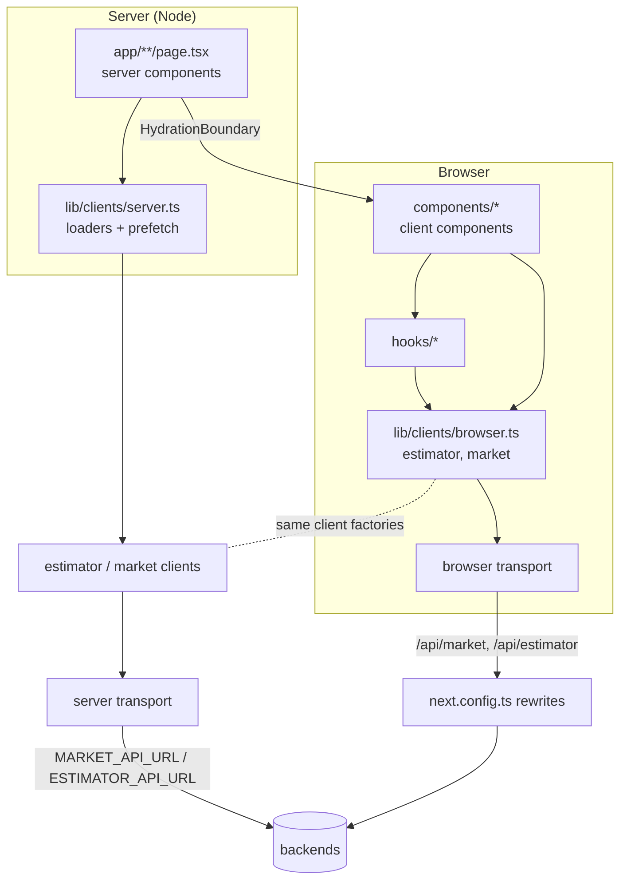
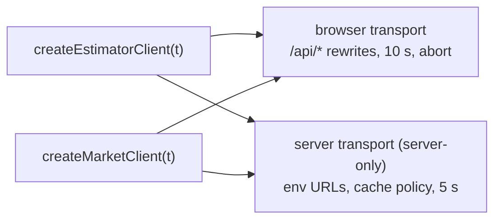
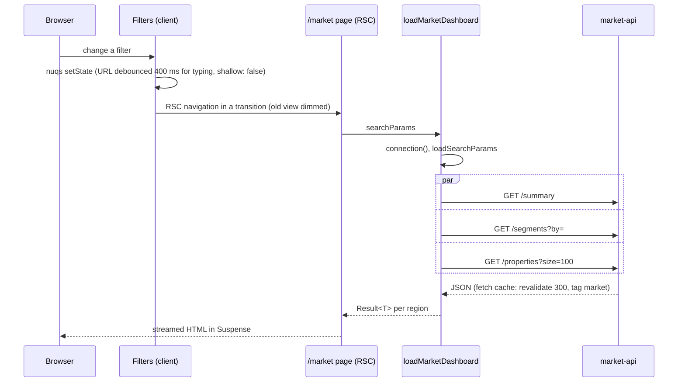

# web architecture

## Layers

| Layer | Where | Rule |
|---|---|---|
| Routes | `app/` | Server components by default. Read `searchParams`, call a loader or prefetch, render. No `fetch` of their own. |
| Client components | `components/` with `"use client"` | Interactivity only: forms, charts, sliders, tables. Data through hooks. |
| Hooks | `hooks/` | Only hooks that add behaviour: `useCreateEstimate` / `useDeleteEstimate` (thin over the client mutations), `useWhatIf` and `useDebounce`, `useMarketFilters` (URL state). Plain reads are `useQuery(estimator.queries.x())` in the component. |
| Clients | `lib/clients/` | The only code that knows backend paths, query keys, cache policy, error mapping and invalidation. |
| Data helpers | `lib/data/` | `query-client.ts` and the nuqs `search-params.ts`. |
| Schemas/format | `lib/house-schema.ts`, `lib/format.ts`, `lib/types.ts` | Shared by forms and display. |
| Config | `lib/config.ts` | Timings and tuning (stale times, revalidate, debounces, request timeout, what-if steps), one named constant each. Page sizes stay beside their loaders in `clients/market.ts`. |

### Server vs client components

Pages, layouts and the market `Dashboard` are server components; the market app is mostly server-rendered from the URL. The estimator app is interactive (form, mutations, selection), so its pages only prefetch on the server and hand off to client components. Charts are client components (Recharts).

## The `lib/clients` layer

One module per backend. A client is built as `createEstimatorClient(transport)` / `createMarketClient(transport)`; the transport is the only thing that differs between the browser and the server.

| Concern | Estimator client | Market client | Owner |
|---|---|---|---|
| Paths | `estimator-paths.ts` | `market-paths.ts` | One dependency-free list per backend; `next.config.ts` builds the rewrite allow-list from it too |
| Query keys + `queryOptions` | `queries.estimates / estimatesByIds / modelInfo` | `queries.whatIf` | The client; browser and server prefetch call the same builders |
| Mutations + invalidation | `mutations.create / delete(qc)`, both invalidate `["estimates"]` | none | The client; hooks only call `useMutation(client.mutations.x(qc))` |
| Server reads | via `prefetchQuery` (TanStack) | `dashboard(raw)`, `properties(raw)` returning `Result<T>` | Client, driven by `lib/clients/server.ts` |
| Error mapping | `errors.ts`: `ApiError`, `readDetail`, `errorMessage`, `REQUEST_ID_HEADER` | same | Shared; each transport turns a failed response into an `ApiError` |

| | Browser transport (`transport.ts`) | Server transport (`server-transport.ts`) |
|---|---|---|
| URL | `/api/estimator`, `/api/market` (rewrites) | `ESTIMATOR_API_URL`, `MARKET_API_URL` from `lib/backends.ts` |
| Timeout | `REQUEST_TIMEOUT_MS` 10 s, combined with TanStack's `signal`; a caller abort is re-thrown untouched | `SERVER_REQUEST_TIMEOUT_MS` 5 s (renders block on it): "The … service timed out" |
| Cache / headers | none; no `X-Request-ID` (the backend generates it) | estimator: `no-store` + fresh `X-Request-ID`; market: `revalidate` 300 s, no request id (it would split the fetch cache) |
| Errors | `readDetail` (FastAPI 422 list), 5xx fallback text, `X-Request-ID` into `ApiError.requestId` | same `readDetail`; `unstable_rethrow` first in the catch so Next's own errors propagate (a timeout is not one) |

Why the market client is thinner: its reads are server loaders returning `Result<T>` (partial failure per region), not TanStack prefetches, so it has no query keys, no invalidation and no mutations. Only the what-if call goes through the browser, plus the export links (`market.exportUrl`).

Wiring: `browser.ts` builds both clients over the browser transport (components and hooks import `estimator` / `market` from there); `server.ts` (`server-only`) builds them over the server transport and exports `loadMarketDashboard`, `loadProperties` and the `prefetch*` helpers, which call `connection()` first. `lib/data/query-client.ts` (`getQueryClient()`: new client per server request, singleton in the browser; defaults `staleTime` 30 s, `retry` 1, pending queries dehydrated) and `lib/data/search-params.ts` (nuqs parsers shared by the RSC loader, `useQueryStates` and `createSerializer`) stay where they were.

To add an estimator endpoint: add the path to `estimator-paths.ts` (and to `ESTIMATOR_PROXIED` if the browser calls it), then a `queries` entry or mutation in `estimator.ts`.

`npm test` (vitest, node environment, specs next to the code) covers: the clients and transports against a fake `fetch` (error mapping, timeouts, abort, key/path equality, invalidation, the `page`/`sort` translation for market-api), the URL parsers, formatters, the zod house schema, and `lib/contracts.test.ts`, which compares the zod schema, segment/sort keys, filter parsers and what-if steps with `../contracts`. `npm run e2e` (Playwright, `e2e/`) drives the market filters, properties, what-if and estimator pages in Chrome against a running compose stack; it is not in CI.

## Request flow: market dashboard

## RSC prefetch and `HydrationBoundary`

Estimator pages and `/market/what-if` create a query client, `await prefetch...(qc)` and wrap the client component in `<HydrationBoundary state={dehydrate(qc)}>`. The first paint has data and the client hooks take over (refetch, mutations, invalidation). `prefetchQuery` swallows errors and a failed query isn't dehydrated, so the client hook retries and shows its own error state.

## Rewrites, headers and icon

Rewrites are an allow-list built from `ESTIMATOR_PROXIED` / `MARKET_PROXIED` in `lib/clients/*-paths.ts`, so the backends' `/docs` and `/openapi.json` are not exposed. `headers()` adds nosniff, a strict referrer policy, `X-Frame-Options: DENY` plus CSP `frame-ancestors 'none'` and a `Permissions-Policy` for all routes (no full CSP: it would have to allow Next's inline scripts). The icon is `app/icon.svg`.

## Rewrites vs runtime env

`next.config.ts` rewrites are resolved at `next build` and stored in the routes manifest; `lib/clients/server-transport.ts` reads the same env vars at runtime. The default URLs for both live in `lib/backends.ts` (compose hostnames, or `localhost` under `next dev`). Hence the Dockerfile passes `ESTIMATOR_API_URL` and `MARKET_API_URL` both as build args and as runtime env, and compose sets both.

## Caching policy

| Data | Where | Policy |
|---|---|---|
| Market reads (server) | Next fetch cache | `next: { revalidate: 300 }`: shared, read-only data (no cache tag; add one with `revalidateTag` once data can change at runtime) |
| Estimator reads (server) | none | `cache: "no-store"`: user data |
| All server loaders | | `await connection()` first, so pages are rendered per request, never prerendered at build when backends are absent |
| Browser queries | TanStack Query | `staleTime` 30 s; model info 10 min; what-if keyed by the serialized request with `keepPreviousData` |
| Mutations | TanStack Query | create/delete invalidate `["estimates"]` |

## URL-driven filters

Market filters, segment (`by`), sort and page live in the query string. URL state is managed by nuqs (`NuqsAdapter` in `app/providers.tsx`; parsers in `lib/data/search-params.ts`). `useMarketFilters` wraps `useQueryStates` with `shallow: false` and a `startTransition`, so the server components re-render and `isPending` dims the old view; nuqs queues rapid changes and keeps inputs in sync with the URL (Reset, shared links). Updates use `replace`, so Back/Forward does not step through filter changes; that is deliberate. Number inputs use `limitUrlUpdates: debounce(400)`: the input updates at once, the URL follows when typing stops. Sort is two params (`?sort=price&dir=desc`); `loadProperties` translates it to market-api's `sort=price,desc`. Defaults are cleared from the URL (`clearOnDefault`). The dashboard's `Suspense` is keyed by the params, so every view is shareable and bookmarkable.

## Errors

- **Contract:** every backend error is `{detail}`. both transports map errors through the shared `readDetail` (a string `detail`, or FastAPI's 422 issue list flattened to `field: message`); otherwise a generic message by status (a browser 5xx without `detail` means the rewrite proxy couldn't reach the backend). The browser transport aborts after 10 s (`ApiError(0, "The request timed out…")`) and honours a caller `signal`; every `queryFn` passes TanStack's `signal`, and a cancellation is re-thrown as-is so it never shows as an error. The server transport aborts after 5 s ("The … service timed out") so a hung backend can't hang a render.
- **`Result<T>` loaders:** `attempt()` (in `clients/market.ts`) turns each server fetch into `{ok, data} | {ok:false, error}`. Production strips messages thrown from server components, so loaders return them as data; one failed region (say segments) shows an inline `ErrorState` while the rest renders. `unstable_rethrow` (in `attempt()` and the server transport) lets Next's own control-flow errors through.
- **Request id:** server-side estimator reads (the server transport, uncached) send a fresh `X-Request-ID` UUID. The market reads don't: Next includes request headers in the fetch cache key, so a per-request id would defeat the 300 s cache; market-api generates its own. Browser calls through the rewrites carry none either. The browser transport copies the response's `X-Request-ID` to `ApiError.requestId`, and `errorMessage()` (the one place toasts get their text) appends `· ref <first 8 chars>`.
- **Boundaries:** `app/error.tsx`, `app/market/error.tsx`, `app/estimator/error.tsx` share `RouteError` (generic text when the error has a `digest`), `global-error.tsx` covers the root layout, plus `not-found.tsx`. Mutations report through toasts.

## Accessibility

- Skip link to `#main`; `main` is focusable.
- `nav` landmarks with labels and `aria-current="page"`.
- Form fields: `aria-invalid`, `aria-describedby` hints and errors, errors in `aria-live="polite"`.
- Charts are `aria-hidden` with an `sr-only` table (caption, `scope`) carrying the same data.
- Sortable headers set `aria-sort`; icon-only buttons have `aria-label`s; the "Best" badge in compare has `sr-only` text.
- Loading skeletons use `role="status"`; errors use `role="alert"`; filter results set `aria-busy` while pending.
- Each what-if slider thumb has its own label ("From …", "To …" plus the feature).
- Route transition animation is disabled under `prefers-reduced-motion`.

## Key decisions

| Decision | Why |
|---|---|
| Rewrites instead of API route handlers | Zero proxy code, same origin for the browser (no CORS), backends stay off the public internet. |
| TanStack Query + RSC prefetch instead of Server Actions | The estimator needs client caching, mutations and invalidation; prefetch keeps the first paint fast. |
| Market app server-rendered from the URL | Shareable views, no client state to sync, and the cache can sit at the fetch layer. |
| `Result<T>` instead of throwing | Partial failure per region and readable messages in production. |
| One client per backend, over a transport | Paths, keys, error mapping and invalidation live in one place; browser and server prefetch share the same `queryOptions` and differ only in the fetcher. |
| zod bounds mirror the backends | Instant field errors without a round-trip. `lib/contracts.test.ts` compares them with `contracts/` (also segment/sort keys, filter parsers, what-if steps) as part of `npm test`, in `mise run lint:web` and CI. |

## Known limitations and next steps

- Gates are lint, `tsc`, `next build` and the vitest suite; Playwright e2e runs locally against the compose stack, not in CI. No component tests yet.
- The `market` fetch tag is reserved for an on-demand `revalidateTag("market")` once on-the-fly retraining or data reloads exist (see "Future improvements" in the root [ARCHITECTURE.md](../ARCHITECTURE.md)). No code calls it yet; the data is static and the 300 s revalidate covers it.
- The scatter plot fetches up to 100 properties, which covers the 50-row dataset only.
- Backend URLs are baked into the image at build time; changing them needs a rebuild.
