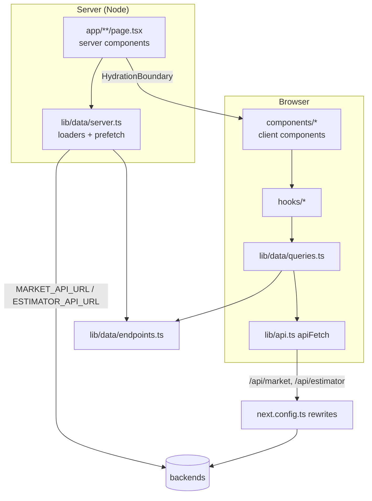
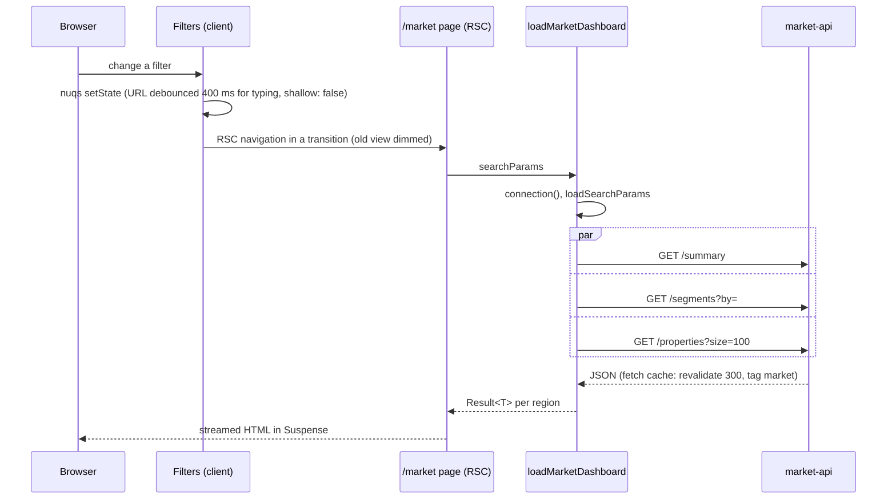

# web architecture

## Layers

| Layer | Where | Rule |
|---|---|---|
| Routes | `app/` | Server components by default. Read `searchParams`, call a loader or prefetch, render. No `fetch` of their own. |
| Client components | `components/` with `"use client"` | Interactivity only: forms, charts, sliders, tables. Data through hooks. |
| Hooks | `hooks/` | Thin wrappers over `queries.ts` and mutations; URL state in `use-market-filters`. |
| Data | `lib/data/` | The only code that knows backend paths, query keys and cache policy. |
| Schemas/format | `lib/house-schema.ts`, `lib/format.ts`, `lib/types.ts` | Shared by forms and display. |

### Server vs client components

Pages, layouts and the market `Dashboard` are server components; the market app is mostly server-rendered from the URL. The estimator app is interactive (form, mutations, selection), so its pages only prefetch on the server and hand off to client components. Charts are client components (Recharts).

## The `lib/data` layer

| File | Role | Why this shape |
|---|---|---|
| `endpoints.ts` | Base paths (`/api/market`, `/api/estimator`), every backend path, `SORT_KEYS`, `exportUrl` | Paths are shared by server and browser code. |
| `search-params.ts` | nuqs parsers for every URL param (`filterParsers`, `marketParsers`, `propertiesParsers`) and the server `loadSearchParams` | One definition shared by the RSC loaders, `useQueryStates` and `createSerializer`; invalid values fall back to defaults. |
| `queries.ts` | `queryOptions` factories: the only place query keys exist | Hooks, server prefetch and invalidation can't drift apart. `estimatesByIds` nests under `["estimates"]` so one invalidation covers both. |
| `server.ts` | `server-only` loaders (`loadMarketDashboard`, `loadProperties`) and prefetchers (`prefetchModelInfo`, `prefetchEstimates`, `prefetchEstimatesByIds`) | Server code reaches backends by internal URL and owns caching; `server-only` stops it leaking into the client bundle. |
| `query-client.ts` | `getQueryClient()`: new client per server request, singleton in the browser | Never share one user's cache across requests; defaults `staleTime` 30 s, `retry` 1, and pending queries are dehydrated too. |

The prefetchers reuse the `queryOptions` from `queries.ts` and only swap `queryFn` for a server fetch, so the key the server fills is the key the client reads.

## Request flow: market dashboard

## RSC prefetch and `HydrationBoundary`

Estimator pages and `/market/what-if` create a query client, `await prefetch...(qc)` and wrap the client component in `<HydrationBoundary state={dehydrate(qc)}>`. The first paint has data and the client hooks take over (refetch, mutations, invalidation). `prefetchQuery` swallows errors and a failed query isn't dehydrated, so the client hook retries and shows its own error state.

## Rewrites vs runtime env

`next.config.ts` rewrites are resolved at `next build` and stored in the routes manifest; `lib/data/server.ts` reads the same env vars at runtime. Hence the Dockerfile passes `ESTIMATOR_API_URL` and `MARKET_API_URL` both as build args and as runtime env, and compose sets both.

## Caching policy

| Data | Where | Policy |
|---|---|---|
| Market reads (server) | Next fetch cache | `next: { revalidate: 300, tags: ["market"] }`: shared, read-only data |
| Estimator reads (server) | none | `cache: "no-store"`: user data |
| All server loaders | | `await connection()` first, so pages are rendered per request, never prerendered at build when backends are absent |
| Browser queries | TanStack Query | `staleTime` 30 s; model info 10 min; what-if keyed by the serialized request with `keepPreviousData` |
| Mutations | TanStack Query | create/delete invalidate `["estimates"]` |

## URL-driven filters

Market filters, segment (`by`), sort and page live in the query string. URL state is managed by nuqs (`NuqsAdapter` in `app/providers.tsx`; parsers in `lib/data/search-params.ts`). `useMarketFilters` wraps `useQueryStates` with `shallow: false` and a `startTransition`, so the server components re-render and `isPending` dims the old view; nuqs queues rapid changes and keeps inputs in sync with Back/Forward and Reset. Number inputs use `limitUrlUpdates: debounce(400)`: the input updates at once, the URL follows when typing stops. Sort is two params (`?sort=price&dir=desc`); `loadProperties` translates it to market-api's `sort=price,desc`. Defaults are cleared from the URL (`clearOnDefault`). The dashboard's `Suspense` is keyed by the params, so every view is shareable and bookmarkable.

## Errors

- **Contract:** every backend error is `{detail}`. `apiFetch` (browser) and `request` (server) surface a string `detail`; otherwise a generic message by status (5xx without `detail` means the rewrite proxy couldn't reach the backend). `apiFetch` also aborts after 10 s (`ApiError(0, "The request timed out…")`) and honours a caller `signal`; every `queryFn` passes TanStack's `signal`, and a cancellation is re-thrown as-is so it never shows as an error.
- **`Result<T>` loaders:** `attempt()` turns each server fetch into `{ok, data} | {ok:false, error}`. Production strips messages thrown from server components, so loaders return them as data; one failed region (say segments) shows an inline `ErrorState` while the rest renders. `unstable_rethrow` lets Next's own control-flow errors through.
- **Boundaries:** `app/error.tsx`, `app/market/error.tsx`, `app/estimator/error.tsx` share `RouteError` (generic text when the error has a `digest`), `global-error.tsx` covers the root layout, plus `not-found.tsx`. Mutations report through toasts.

## Accessibility

- Skip link to `#main`; `main` is focusable.
- `nav` landmarks with labels and `aria-current="page"`.
- Form fields: `aria-invalid`, `aria-describedby` hints and errors, errors in `aria-live="polite"`.
- Charts are `aria-hidden` with an `sr-only` table (caption, `scope`) carrying the same data.
- Sortable headers set `aria-sort`; icon-only buttons have `aria-label`s; the "Best" badge in compare has `sr-only` text.
- Loading skeletons use `role="status"`; errors use `role="alert"`; filter results set `aria-busy` while pending.
- Route transition animation is disabled under `prefers-reduced-motion`.

## Key decisions

| Decision | Why |
|---|---|
| Rewrites instead of API route handlers | Zero proxy code, same origin for the browser (no CORS), backends stay off the public internet. |
| TanStack Query + RSC prefetch instead of Server Actions | The estimator needs client caching, mutations and invalidation; prefetch keeps the first paint fast. |
| Market app server-rendered from the URL | Shareable views, no client state to sync, and the cache can sit at the fetch layer. |
| `Result<T>` instead of throwing | Partial failure per region and readable messages in production. |
| Query keys only in `queries.ts` | Prefetch, hooks and invalidation share one source. |
| zod bounds mirror the backends | Instant field errors without a round-trip. |

## Known limitations and next steps

- No automated tests (unit or e2e); lint, `tsc` and `next build` are the only gates.
- The `market` fetch tag is never revalidated (no `revalidateTag` call); entries expire after 300 s.
- The scatter plot fetches up to 100 properties, which covers the 50-row dataset only.
- A 422 from the estimator carries a list `detail`, which the UI shows as `Request failed (422)`; client-side zod validation normally prevents it.
- Backend URLs are baked into the image at build time; changing them needs a rebuild.
